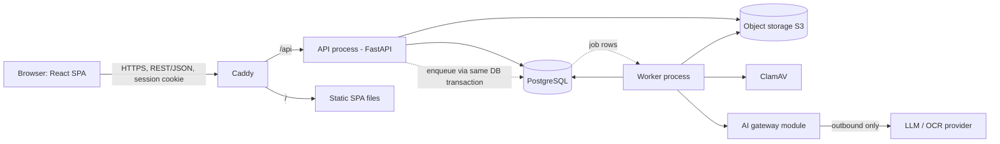
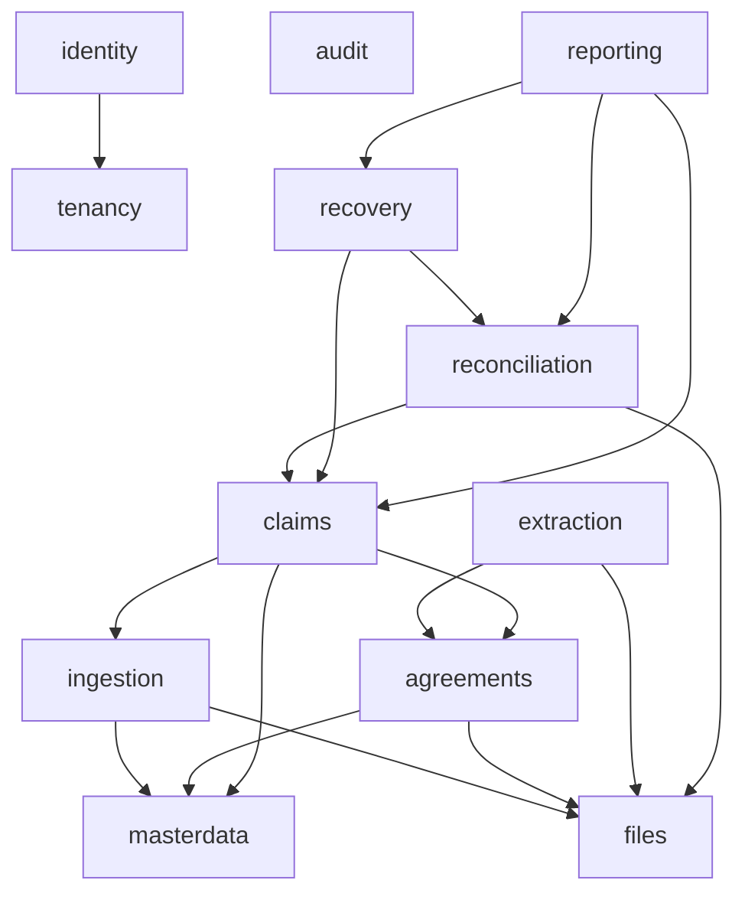
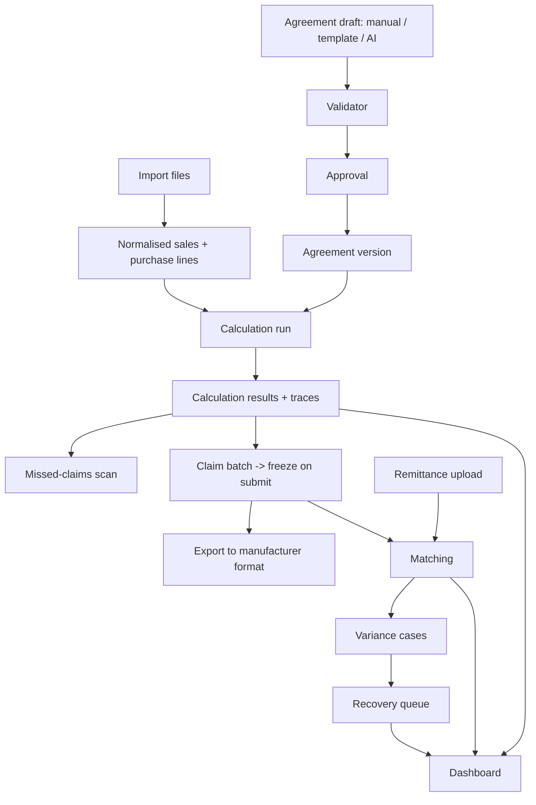

# Architecture

> Decisions and rationale: `ARCHITECTURE_DECISIONS.md`. Tables: `DATABASE_SCHEMA.md`. Endpoints: `API_SPECIFICATION.md`.

## 1. Overview

A **modular monolith**: one Python codebase, deployed as two processes (`api`, `worker`), one PostgreSQL database, one S3-compatible object store. A separate React SPA is served as static files.



Principles:

1. **One transactional database** is the source of truth, including the job queue and the audit log.
2. **Pure core:** calculation (`rebate_engine`) and matching (`rebate_matching`) are pure Python packages with no DB, network, clock, or randomness. They take values and return values plus a trace.
3. **AI is an input device, not a decision maker.** It writes only to draft/proposal tables through a restricted path.
4. **Immutability over mutation** for anything financial. Corrections are new records.
5. **Tenant isolation at two layers:** application policy and Postgres RLS.

## 2. Repository layout

```
rebate-recovery/
├── CLAUDE.md
├── README.md
├── docs/                      # this documentation package
├── backend/
│   ├── pyproject.toml, uv.lock, alembic.ini, importlinter.ini
│   ├── migrations/            # Alembic versions (forward-only)
│   ├── src/
│   │   ├── rebate/            # application package
│   │   │   ├── core/          # config, db session, tenancy context, security, errors, logging, clock, ids
│   │   │   ├── api/           # FastAPI app factory, middleware, deps, v1 routers aggregation
│   │   │   ├── modules/       # business modules (see §3)
│   │   │   └── workers/       # job definitions registry, worker entrypoint, scheduler
│   │   ├── rebate_engine/     # PURE calculation package (no imports from rebate/)
│   │   └── rebate_matching/   # PURE matching package (no imports from rebate/)
│   └── tests/
│       ├── unit/ integration/ api/ db/ isolation/ engine_golden/ extraction/ security/ performance/
├── frontend/
│   ├── src/ (app/, features/<module>/, components/, lib/api/, lib/format/)
│   └── e2e/
├── testdata/                  # SYNTHETIC data + ground truth (see TEST_DATA_SPEC.md)
├── infra/                     # docker/, caddy/, scripts/ (backup, restore, init db)
└── .github/workflows/
```

Each module in `rebate/modules/<name>/` has the same shape:

```
__init__.py        # public interface: the ONLY thing other modules may import
models.py          # SQLAlchemy models (tables owned by this module)
schemas.py         # Pydantic request/response/DTO models
repository.py      # all SQL for this module
service.py         # business operations; transaction boundaries; emits audit entries
policies.py        # authorization rules (permission checks)
router.py          # FastAPI router (thin: parse, authorise, call service, shape response)
jobs.py            # background job handlers (thin: call service)
```

## 3. Modules and dependencies



Rules (enforced by `import-linter` in CI):
- Modules import only another module's `__init__` interface, never its internals or tables.
- `audit`, `files`, `identity`/`tenancy` are foundation modules, importable by all.
- `rebate_engine` and `rebate_matching` import nothing from `rebate`. The `claims` and `reconciliation` services are the adapters that load data, call the pure packages, and persist results.
- No cycles.

| Module | Owns | Responsibility |
|---|---|---|
| `identity` | users, sessions, MFA, invitations, reset tokens | Authentication, session lifecycle |
| `tenancy` | tenants, memberships, settings | Workspaces, roles, RBAC policy |
| `audit` | `audit_log` | Append-only audit writing/search; sealing job |
| `files` | `file_objects` | Upload, quarantine, scan, hash, presigned download |
| `masterdata` | manufacturers, customers, products, aliases, UoM, branches, manufacturer settings | Reference data and matching of external identifiers |
| `ingestion` | import batches, mapping templates, source transaction tables | Parse → normalise → validate → load with de-duplication |
| `agreements` | agreements, versions, drafts, items, customers, tiers | Drafting, validation, approval, versioning |
| `extraction` | document extractions, AI invocation log, AI gateway | Document → structured draft (AI), only writes drafts |
| `claims` | calculation runs/results, accrual entries, claim batches/lines/adjustments, export templates | Orchestrate engine, freeze, export |
| `reconciliation` | remittance documents/lines, matches | Ingest remittances, orchestrate matching |
| `recovery` | variance cases/events, notifications | Case workflow, deadlines, notifications |
| `reporting` | summary tables/views | Dashboard, tier tracker, trace export |

## 4. Request lifecycle (API)

```mermaid
sequenceDiagram
  participant B as Browser
  participant M as Middleware
  participant R as Router
  participant P as Policy
  participant S as Service
  participant DB as Postgres
  B->>M: HTTPS request + cookie (+ X-CSRF-Token on writes)
  M->>M: request_id, rate limit, session lookup, CSRF check
  M->>R: authenticated principal + active tenant
  R->>R: Pydantic validation
  R->>P: permission check (role -> action)
  P-->>R: allow/deny
  R->>S: call service
  S->>DB: BEGIN; SET LOCAL app.tenant_id; ...queries...
  S->>DB: INSERT audit_log (same tx)
  S->>DB: COMMIT
  S-->>R: result DTO
  R-->>B: JSON (money as strings), request_id header
```

Transaction rule: **one request = one transaction**, tenant context set at the start with `SET LOCAL` (never session-level). The DB session dependency enforces this; services never open their own connections.

## 5. API architecture

REST/JSON over HTTPS, versioned under `/api/v1`, OpenAPI at `/api/v1/openapi.json` (disabled in production unless authenticated). Cursor pagination, idempotency keys on creation of financial records, one error envelope. Full rules in `API_SPECIFICATION.md`.

## 6. Background workers

Same codebase, separate process (`python -m rebate.workers`). Queue: Procrastinate on Postgres.

Rules:
- Enqueue **inside the same transaction** as the data change (no "saved but never queued").
- Every job payload carries `tenant_id` and `actor_id` (or `system`). The worker re-establishes tenant context (`SET LOCAL app.tenant_id`) before touching tenant data. A job without tenant context for tenant-scoped work fails.
- Jobs are idempotent (safe to run twice) and resumable (checkpoint progress in a status row).
- Retries: bounded (default 5) with exponential backoff and jitter for transient errors; permanent errors (validation, schema) fail immediately. Terminal state `failed` is visible in the admin UI and alerts.
- Long jobs (imports, calculation runs) process in chunks, committing per chunk with progress counters.
- Calculation runs take a per-tenant advisory lock so two runs for the same scope cannot overlap.

| Job | Trigger | Output |
|---|---|---|
| `scan_file` | upload | `file_objects.scan_status` |
| `parse_import` | file clean | staged rows + errors |
| `load_import` | user confirms | source tables |
| `suggest_mapping` | unmapped header | mapping suggestion (AI, optional) |
| `extract_agreement` | user request | `agreement_draft` (AI) |
| `extract_remittance` | upload of PDF | `remittance_extraction` for human confirmation |
| `run_calculation` | user request | `calculation_results`, accrual entries |
| `run_reconciliation` | remittance confirmed | matches, variance cases |
| `build_export` | user request | export file |
| `deadline_sweep` (periodic) | schedule | notifications |
| `agreement_expiry_sweep` (periodic) | schedule | status updates, notifications |
| `audit_seal` (periodic) | schedule | hash chain |
| `refresh_summaries` (periodic/after runs) | schedule/event | dashboard summary tables |

## 7. AI processing architecture

Summarised here; full detail in `AI_PROCESSING.md`.

```mermaid
flowchart LR
  F[File: PDF/XLSX/CSV] --> SC[Scan + validate]
  SC --> TX[Text/table extraction + OCR fallback]
  TX --> AIG[AI gateway]
  AIG -->|schema-constrained output| EX[document_extractions]
  EX --> V[Deterministic validator]
  V --> DR[agreement_drafts - status draft]
  DR --> HR[Human review + approval]
  HR -->|approver permission| AV[agreement_versions - immutable]
  AV --> ENG[Deterministic engine]
```



The **only** path from AI output to a financial rule is: extraction → validator → draft → human approval → version. The AI gateway runs under a database role (`rebate_ai_writer`) that can `INSERT` into `document_extractions`/`ai_invocations` and `agreement_drafts` only. It cannot write any other table.

## 8. File storage architecture

- Bucket layout: `tenants/{tenant_id}/{kind}/{yyyy}/{mm}/{file_id}`; kinds: `imports`, `agreements`, `remittances`, `exports`, `attachments`. Quarantine prefix `quarantine/{tenant_id}/{file_id}` until scan = clean, then copied to final key.
- API uploads stream to quarantine, compute SHA-256, create `file_objects` (`scan_status=pending`) and enqueue `scan_file`.
- Downloads use presigned URLs (≤ 5 min), generated only after a policy check, and logged.
- Objects are server-side encrypted; versioning enabled; separate bucket for backups.

## 9. Authentication and multi-tenancy

- **Auth:** server-side sessions stored in Postgres (`sessions`), opaque random 256-bit token in an `HttpOnly; Secure; SameSite=Lax` cookie, rotated at login and privilege change; idle (30 min) and absolute (12 h) timeouts; TOTP MFA; CSRF double-submit header on mutating requests. Details: `SECURITY.md`.
- **Tenancy:** shared schema; `tenant_id` on every tenant-owned table; composite foreign keys `(tenant_id, id)`; RLS policies using `current_setting('app.tenant_id')`; app role without `BYPASSRLS`. Users are global identities; `memberships` bind a user to a tenant with a role. Active tenant is chosen per session and re-validated against membership on each request.

## 10. Core data flow (end to end)



Traceability chain (schema-enforced; see `DATABASE_SCHEMA.md` §6):

```
file_object → import_batch → source row (sales_document_line)
  → calculation_result (agreement_version + rule + engine version + trace)
  → claim_line → claim_batch → reconciliation_match
  → remittance_line → remittance_document → variance_case → outcome
```

## 11. Workflow specifications and failure handling

Each workflow lists FE (frontend), BE (backend API), DB, WK (worker), AI, and failure handling.

### W1 Registration and workspace creation
- FE: registration form → email verification → MFA setup.
- BE: `POST /auth/register` creates `users`, `tenants`, `memberships(admin)`, default settings, audit entry — one transaction. Sends verification email.
- DB: rows in `tenants`, `users`, `memberships`, `tenant_settings`, `audit_log`.
- WK: `send_email`. AI: none.
- Failures: email failure → retry job, account stays unverified; duplicate email → generic response; partial creation impossible (single transaction).

### W2 Invitations and roles
- FE: Admin → Users → Invite (email, role). BE: `POST /invitations` stores token hash (never the token), enqueues email. Accepting: `POST /invitations/{token}/accept`.
- Failures: expired/used token → 410 with generic message; role change by non-admin → 403 + audit entry of denied attempt (rate-limited).

### W3 Import sales/purchase data
- FE: upload → file listed as `scanning` → mapping step → preview with errors → confirm.
- BE: `POST /files` (stream, hash, quarantine) → `POST /imports` (file, type, template) → job chain. `POST /imports/{id}/confirm`.
- WK: `scan_file` → `parse_import` (strings only, staged rows, errors) → on confirm `load_import` (chunks, `INSERT … ON CONFLICT`, content-hash compare).
- DB: `file_objects`, `import_batches`, `import_row_errors`, source tables (with `import_batch_id` and `source_row_number`).
- Failures: infected file → `rejected`, visible reason; parse crash/timeouts → batch `failed`, retriable; mid-load crash → resumable by chunk checkpoint, idempotent by natural key; duplicate file → "already imported on …".

### W4 Validate and process uploads
Same pipeline as W3: structural validation (headers, required columns), row validation (types, ranges, referential checks to master data and original invoice for credit notes), unmapped entities go to a review queue instead of failing the file.

### W5 Upload agreement document
- FE: Agreements → New → "Upload document" or "Enter manually" or "Import SPA items (template)".
- BE: file upload as W3; `POST /agreement-drafts` with `source_file_id`. Manual path: `POST /agreement-drafts` with the form payload directly.
- Failures: unsupported type rejected at upload; encrypted PDF → `needs_manual_entry` with reason.

### W6 AI extraction
- WK `extract_agreement`: text extraction → (OCR if no text layer) → AI gateway (two independent passes) → schema validation → evidence verification → deterministic validators → `agreement_drafts` (status `draft`, source `ai_extraction`) + `document_extractions` (full record).
- AI: structured extraction only. No eligibility or amount decisions.
- Failures: provider outage/timeouts → retry with backoff → `extraction.status = failed`, draft not created, UI offers manual entry; invalid JSON → one repair attempt then fail; hidden-text injection patterns flagged; unverifiable fields left empty and marked `unsupported`.

### W7 Human review and approval
- FE: side-by-side review; edits create a new draft revision (`draft_revision`); submit for approval.
- BE: `POST /agreement-drafts/{id}/submit`, `POST /agreement-drafts/{id}/approve` (permission `agreement.approve`; four-eyes check; validator re-run server-side; overlap check; creates `agreement_versions`; split-supersede if amendment). One transaction + audit.
- Failures: validator fails at approval → 422 with field errors; concurrent approvals → row lock, second gets 409.

### W8 Claims calculation
- FE: Claims → New run (manufacturer(s), period, as-of). BE: creates `calculation_runs` (status `queued`, pinned inputs recorded) and enqueues `run_calculation`.
- WK: advisory lock on (tenant, scope) → load lines and active versions as of → call `rebate_engine.calculate_*` per line/agreement group → batch insert `calculation_results` (+ `rebate_accrual_entries`) → mark run `completed`, store totals and checksums.
- Failures: crash mid-run → run `failed`, partial results discarded (results are written in a single run-scoped transaction per chunk and marked `run_status` only at completion; incomplete runs are invisible to claim building); concurrent run → 409.

### W9 Claim generation
- FE: select eligible results → build batch → review → approve → export → record submission.
- BE: `POST /claim-batches` (selects result ids, locks them against double-claiming via unique constraint on `claim_lines(calculation_result_id)` for non-void batches), `POST /claim-batches/{id}/approve|export|submit|void`.
- DB: `claim_batches`, `claim_lines`; submission trigger freezes lines.
- Failures: line already in another batch → 409 listing lines; export job failure → retry; submission recorded twice → idempotency key.

### W10 Manufacturer credit memo arrives
- FE: Reconciliation → Upload remittance (CSV/XLSX/PDF), choose manufacturer and channel.
- BE/WK: file pipeline; CSV/XLSX via mapping template; PDF via `extract_remittance` (AI + arithmetic validation: sum of lines = document total) → human confirmation step before lines are accepted.
- Failures: arithmetic mismatch → blocks acceptance with diff shown; duplicate remittance (same hash or manufacturer + doc number) → 409.

### W11 Reconcile claimed vs paid
- WK `run_reconciliation`: deterministic tiers (`BUSINESS_LOGIC.md` §10) via `rebate_matching`; writes `reconciliation_matches` (`confirmed` for exact tiers, `suggested` otherwise); computes variances.
- FE: side-by-side; user confirms/rejects suggestions; manual match by drag/select.
- Failures: ambiguous matches stay `suggested`; subset-sum search is bounded and times out into "manual review"; re-run never overrides `confirmed` matches.

### W12 Recovery queue
- Variances become `variance_cases` with reason code, amount, deadline (`BUSINESS_LOGIC.md` §12). `deadline_sweep` creates notifications and the daily digest.
- Failures: notification email failure retried; case without a computable deadline is flagged `deadline_unknown` and surfaced at the top of the queue, not hidden.

### W13 Dispute management
- FE: case detail → add notes/attachments → change status; `to_reclaim` cases feed the next claim batch as adjustments; write-off requires approval.
- BE: status transitions validated by a state machine (`recovery/service.py`); every transition is an event row + audit entry.

### W14 Management dashboard
- BE reads `summary_*` tables/materialised views refreshed after runs/reconciliations and on schedule; every figure has a drill-down query returning the underlying rows; totals tested to equal sums of underlying rows.
- Failures: stale summary → UI shows "as of" timestamp; refresh job failure alerts.

## 12. External integrations (Release 1)

| Integration | Direction | Notes |
|---|---|---|
| LLM provider | Outbound | Through AI gateway only; per-tenant opt-out; DPA/zero-retention required (OD-2) |
| OCR | In-process (Tesseract) | Cloud OCR only with owner approval |
| Object storage | Outbound | S3 API |
| SMTP provider | Outbound | Transactional email |
| Sentry | Outbound | PII scrubbed |
| ERPs, EDI, manufacturer portals | None in Release 1 | Design leaves seams: `ingestion` accepts any `SourceAdapter` producing canonical rows |

## 13. Cross-cutting conventions

- **Clock:** all time access via `core.clock.now()` so tests and the engine can inject time. The engine receives `as_of` as a parameter.
- **IDs:** UUIDv7 primary keys generated in the application.
- **Errors:** domain exceptions (`DomainError` subclasses with stable `code`) mapped to the API error envelope; unexpected errors return a generic 500 with `request_id` and are logged with context, never with secrets.
- **Idempotency:** `Idempotency-Key` header stored in `idempotency_keys` (tenant, key, request hash, response) for financial creation endpoints.
- **Config:** typed `Settings` from environment; fail fast on missing secrets in non-dev.
- **Money:** `Decimal` + `NUMERIC`; serialised as strings. Central `Money` helpers in `rebate_engine.money`.
