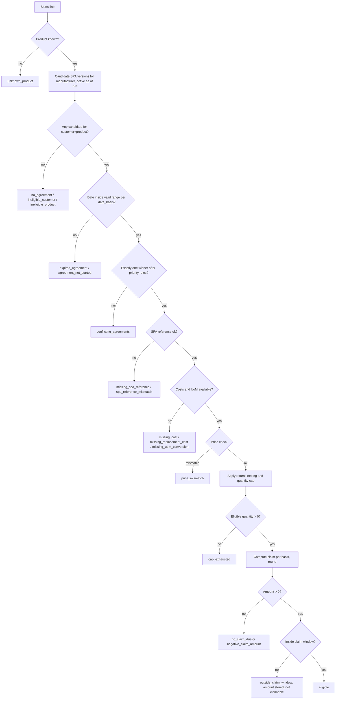
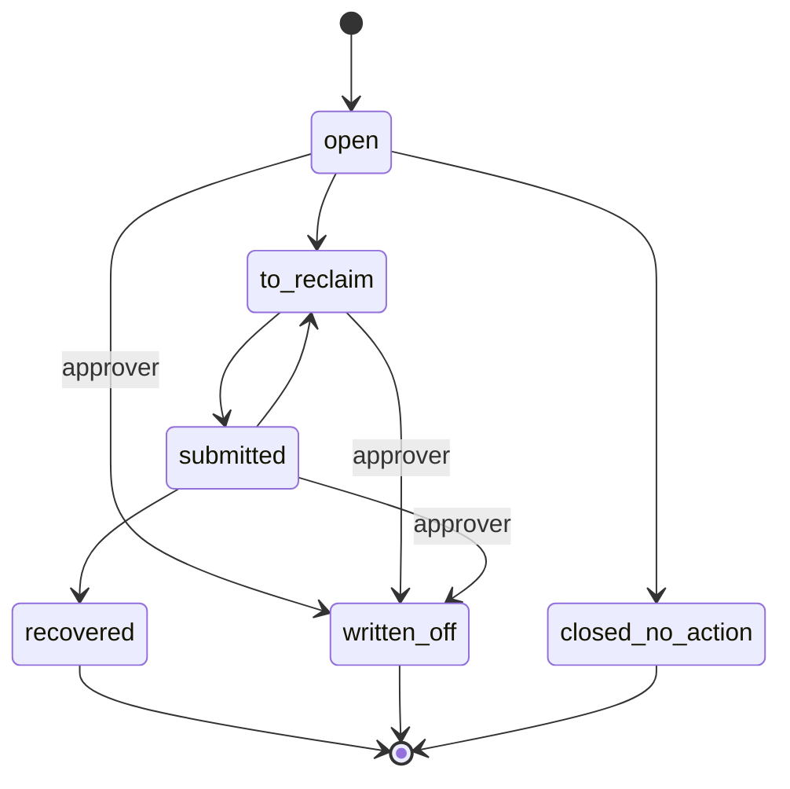

# Business Logic

> **This document is the specification of the calculation engine (`rebate_engine`), the matching package (`rebate_matching`), and the recovery rules.** If code and this document disagree, that is a defect to report, not to resolve silently.
> Every worked example below is reproduced by `testdata/verify_business_logic_examples.py` (plain Python `Decimal`, no app code) and must also exist as a golden test (§14). Domain terminology is based on the product plan and general industry knowledge; real-world terms vary by manufacturer and must be validated against real agreements (A-12).

## 1. Principles and conventions

1. **Deterministic.** Same inputs + same engine version ⇒ identical outputs and trace. No wall clock, randomness, network, or database inside the engine. Time enters only as explicit parameters (`as_of`, `run_date`).
2. **Exact arithmetic.** `decimal.Decimal`, context precision 28, `ROUND_HALF_UP` unless the agreement says otherwise. No floats. Inputs from JSON are strings.
3. **No AI.** Nothing in this document may be decided by an LLM.
4. **Explainable.** Every result carries a `trace` (§13).
5. **Stable ordering.** Lines are processed in a total order: `(invoice_date, document_number, line_number)`, then `id` as the final tiebreaker. Quantity caps and running totals depend on it.
6. **Dates.** All comparisons are on `date` values and inclusive at both ends. Each agreement version names its `date_basis` (`invoice_date` or `ship_date`); if `ship_date` is chosen and the line has none, it falls back to `invoice_date` and the trace records the fallback.
7. **Closed set of calculation types**, parameterised by JSON rules (ADR-009). Odd manufacturers use a named adapter (`rules.adapter`), unit-tested and recorded in the trace.
8. **Frozen history.** Submitted claim lines and active agreement versions never change. Corrections are new records (§9).

## 2. Glossary

| Term | Meaning |
|---|---|
| SPA / ship-and-debit / billback | Manufacturer-approved special price for a specific customer/project; the manufacturer reimburses the distributor's cost difference after the sale |
| Reference cost | The cost the claim is measured from (e.g. standard/into-stock cost) |
| Deviated cost | The reduced cost the manufacturer agrees to for the SPA |
| Claim unit amount | Per-unit amount the manufacturer owes |
| Qualifying volume | Volume that counts toward reaching a rebate tier |
| Payout base | Volume that actually earns the rebate rate |
| Retroactive tier | Reaching a tier re-rates **all** volume in the period from the first dollar |
| Incremental tier | Each rate applies only to the volume within its band |
| Variance | Difference between claimed and paid |

## 3. Agreement rules model

### 3.1 SPA rules (`rules.type = "spa"`)

```json
{
  "schema_version": 1,
  "type": "spa",
  "date_basis": "ship_date",
  "calculation": { "basis": "price_difference", "cost_source": "agreement_reference" },
  "customer_scope": { "mode": "listed" },
  "product_scope": { "mode": "listed" },
  "spa_reference": { "required": true },
  "price_check": { "mode": "flag", "tolerance": "0.005" },
  "quantity": { "cap_scope": "per_item" },
  "claim_uom": null,
  "rounding": { "mode": "half_up", "scale": 2, "timing": "per_line" },
  "adapter": null
}
```

| Field | Values | Meaning |
|---|---|---|
| `date_basis` | `invoice_date`, `ship_date` | Which date is tested against the validity period |
| `calculation.basis` | `price_difference`, `percent_of_sell`, `percent_of_cost`, `flat_per_unit`, `guaranteed_margin` | §4 |
| `calculation.cost_source` | `agreement_reference` (item `reference_cost`), `line_cost` (`unit_cost` on the sales line), `replacement_cost` (line `replacement_cost`) | Where the reference cost comes from |
| `customer_scope.mode` | `all`, `listed` (uses `agreement_version_customers`; `include`/`exclude` rows) | |
| `product_scope.mode` | `listed` (items table); rebate agreements may also use `all` | |
| `spa_reference.required` | bool | If true, the line's `spa_reference` must equal the agreement `external_number` (case/space-insensitive) |
| `price_check.mode` | `flag`, `ignore` | If the agreement item has `sell_price`, compare to the line `unit_price` |
| `quantity.cap_scope` | `per_item`, `none`; `per_agreement` = Release 2 (rejected by the validator) | How `max_quantity` is applied |
| `claim_uom` | text or null | Unit the item rates are expressed in; null = product base UoM of the line |
| `rounding` | `mode` (`half_up`,`half_even`,`down`), `scale` (0–6), `timing` (`per_line`,`per_document`) | §6 |
| `adapter` | null or registered name | Escape hatch |

### 3.2 Rebate rules (`rules.type = "rebate"`)

```json
{
  "schema_version": 1,
  "type": "rebate",
  "volume_basis": "purchases",
  "measurement_period": { "kind": "calendar_year", "start": "2026-01-01", "end": "2026-12-31" },
  "tier_mode": "retroactive",
  "tier_metric": "amount",
  "product_scope": { "mode": "all" },
  "spa_lines": "qualify_only",
  "returns": "reduce_volume",
  "rounding": { "mode": "half_up", "scale": 2, "timing": "per_line" }
}
```

| Field | Values | Meaning |
|---|---|---|
| `volume_basis` | `purchases` (net `extended_amount` of purchase receipts less vendor credits), `sales` (net of invoice minus credit-note `extended_amount`) | Measured volume |
| `tier_mode` | `retroactive`, `incremental` | §5 |
| `tier_metric` | `amount`; `quantity` = Release 2 (rejected by the validator) | Thresholds in dollars (units in Release 2) |
| `spa_lines` | `include` (SPA lines qualify and earn), `qualify_only` (count toward threshold, no payout), `exclude` (neither) | Stacking policy; only meaningful when `volume_basis = sales` |
| `returns` | `reduce_volume` | Returns/credits reduce cumulative volume in the period of the return |
| Tiers | in `agreement_version_tiers` | `lower_bound` inclusive; tier 1 starts at 0 |

### 3.3 Agreement payload schema (the single structure for manual, template, and AI drafts)

`agreement_drafts.payload` (and the content of every `agreement_versions` row, split into `rules`, items, customers, tiers) has exactly this shape. Manual entry, spreadsheet-template import, and AI extraction all produce it (`AI_PROCESSING.md` §5 wraps each value with evidence). Samples: `testdata/generated/agreements/manual_payloads/`.

```json
{
  "payload_schema_version": 1,
  "header": {
    "agreement_type": "spa",
    "manufacturer_code": "VOLT",
    "external_number": "SPA-VOLT-2026-884",
    "name": "Voltara contractor SPA 2026",
    "valid_from": "2026-01-01",
    "valid_to": "2026-12-31",
    "priority": 0
  },
  "rules": { "…": "§3.1 or §3.2 rules object" },
  "customers": [ { "customer_code": "ALDER", "scope": "include" } ],
  "items": [ { "sku": "BRK-3P-100A", "reference_cost": "100.00", "deviated_cost": "78.00",
               "sell_price": "88.00", "rate": null, "flat_amount": null, "max_quantity": null, "claim_uom": null } ],
  "tiers": [ { "tier_number": 1, "lower_bound": "0", "rate": "0.015" } ]
}
```

Customers and SKUs are referenced by business code in the payload and resolved to ids at approval (unresolved references block approval). Monetary values are strings. Item fields used depend on `rules.calculation.basis`: `price_difference` → `reference_cost`/`deviated_cost`; `guaranteed_margin`, `percent_of_sell`, `percent_of_cost` → `rate`; `flat_per_unit` → `flat_amount`. For `guaranteed_margin` the margin is the item `rate` (e.g. `0.12`).

**Validator rules (shared by manual and AI drafts):** dates valid and `valid_to ≥ valid_from`; tiers strictly increasing, first = 0, rates in `[0, 1]`; `incremental` is incompatible with `spa_lines = qualify_only` (rejected whatever the `volume_basis`; the engine refuses it too); `cap_scope = per_agreement` and `tier_metric = quantity` are rejected as "not supported until Release 2" (code `not_supported_until_release_2`); SPA agreements need at least one item with a cost basis compatible with `calculation`; required fields per basis (e.g. `percent_*` needs `rate`; `flat_per_unit` needs `flat_amount`; `price_difference` needs `deviated_cost` and a `reference_cost` unless `cost_source ≠ agreement_reference`); `deviated_cost ≥ 0`; `max_quantity > 0` when present; no duplicate items per `(product, customer)`; manufacturer exists; no overlap of active versions for the same agreement.

## 4. SPA claim calculation

### 4.0 Per-line pipeline (first failing gate sets the exception code; all gates evaluated are traced)



Gate details:

1. **Candidate selection.** Versions of type `spa` for the line's manufacturer with `status = 'active'` as of `as_of` (a version activated after `as_of` is invisible; this makes runs reproducible). Candidates are narrowed in three passes so the exception code is informative: (a) by customer scope, (b) by product item, (c) by date. If nothing remains after (a) → `ineligible_customer` (if any agreement exists for the manufacturer) or `no_agreement`; after (b) → `ineligible_product`; after (c) → `agreement_not_started` (line date earlier than every candidate's `valid_from`) or `expired_agreement`.
2. **Conflicts.** If more than one candidate remains: manufacturer `conflict_policy = flag` → `conflicting_agreements` (no amount); `priority` → highest `priority` wins; equal top priority → `conflicting_agreements`. The trace lists all candidates.
3. **SPA reference.** If `spa_reference.required`: line `spa_reference` blank → `missing_spa_reference`; different from the agreement `external_number` → `spa_reference_mismatch`. If not required, a present reference that differs is only a trace warning.
4. **Costs.** Resolve reference cost per `cost_source`; missing → `missing_cost` (or `missing_replacement_cost`).
5. **UoM.** If the line UoM ≠ claim UoM, find the conversion (product-specific first, then tenant default, direct or inverse); none → `missing_uom_conversion`. Converted quantity = `quantity × factor`.
6. **Price check.** If item `sell_price` exists and mode is `flag`: `|unit_price − sell_price| > tolerance` → `price_mismatch`. (Rationale: a manufacturer will usually reject a claim where the invoice price differs from the approved SPA price.) Prices are compared per line UoM; if UoMs differ, the item `sell_price` is interpreted per `claim_uom` and the line price is converted per unit of claim UoM.
7. **Returns netting and cap** (§7 and §4.2).
8. **Amount** (§4.1) and **rounding** (§6).
9. **Claim window.** Deadline = date per manufacturer `claim_window_basis` + `claim_window_days` (§12; for SPA lines `month_end` = last day of the month of the line's claim date; `period_end` applies to rebates only and is rejected for SPA lines). If `run_date > deadline` → `outside_claim_window` (status `exception`, but `claim_amount` is populated so the UI can show the money at risk). If settings are missing, the gate is skipped with a trace warning.

### 4.1 Calculation bases

Let `q` = eligible quantity in claim UoM, `C_ref` = reference cost per claim UoM, `C_dev` = deviated cost, `P` = line sell price per claim UoM.

| Basis | Claim unit amount `u` | Claim amount |
|---|---|---|
| `price_difference` | `C_ref − C_dev` | `q × u` |
| `percent_of_sell` | `P × rate` | `q × u` |
| `percent_of_cost` | `C_ref × rate` | `q × u` |
| `flat_per_unit` | `flat_amount` | `q × u` |
| `guaranteed_margin` | `C_ref − P × (1 − margin)` where `margin = rate` | `q × u` |

`u ≤ 0` → status `not_applicable`, code `no_claim_due` if `u = 0`; `negative_claim_amount` exception if `u < 0` (data problem, flagged for review).

**Example S1 (price difference; the product plan's example).** `C_ref = 100.00`, `C_dev = 78.00`, `q = 100`, sell price 88.00 matches the SPA.
`u = 100.00 − 78.00 = 22.00` → claim = `100 × 22.00 = 2,200.00`. Unit margin check (informational): sell 88 − deviated cost 78 = 10.00.

**Example S3 (guaranteed margin 12%).** `C_ref = 100`, `P = 88`, margin 0.12 → `P × (1 − 0.12) = 77.44`; `u = 22.56`; `q = 100` → **2,256.00**.

**Example S4 (percent of sell 5%).** `P = 88` → `u = 4.40`; `q = 100` → **440.00**.

**Example S5 (flat per UoM with conversion).** Line: 3 reels (RL). Conversion 1 RL = 500 FT. Agreement `claim_uom = FT`, `flat_amount = 0.04`. `q = 3 × 500 = 1,500 FT` → **60.00**.

### 4.2 Quantity caps

`max_quantity` is the authorised quantity (in claim UoM). With `cap_scope = per_item`, consumption is tracked per `(agreement, item)`; `per_agreement` (pooling all items) is Release 2 (rejected by the validator; the engine refuses it whether or not any item has `max_quantity`).

`consumed_before` = quantity already consumed by (a) **claim lines in frozen/active batches** under the same version/item (net of return adjustments), plus (b) earlier lines **in this run's processing order**. Remaining = `max_quantity − consumed_before`.

`eligible_quantity = clamp(q, 0, remaining)`. If `0 < eligible < q`, the line is `eligible` with trace flag `partially_eligible` and the excess quantity is reported. If `remaining ≤ 0` → `cap_exhausted`.

**Example S6.** `max_quantity = 100`, `u = 22.00`. Line A (earlier) q=60 → eligible 60 → 1,320.00. Line B (later) q=60 → remaining 40 → eligible 40 → **880.00**, excess 20 flagged.

Returns restore consumption (§7). A line that ends `outside_claim_window` keeps its `claim_amount` (money at risk) but does **not** consume the cap, so later lines in the window can still use it.

### 4.3 Date validity

**Example S10.** Agreement valid 2026-01-01 → 2026-06-30. Line invoiced 2026-06-28, shipped 2026-07-02.
- `date_basis = ship_date` → 2026-07-02 is after `valid_to` → `expired_agreement`.
- `date_basis = invoice_date` → inside → eligible.
The basis is part of the agreement terms and must be set by the human reviewer (the extractor flags it if the contract is silent).

### 4.4 Price check

**Example S11.** Agreement `sell_price = 88.00`, tolerance 0.005. Line `unit_price = 90.00` → difference 2.00 > tolerance → `price_mismatch`, no amount claimed, line listed in exceptions. With `price_check.mode = ignore` the claim is computed normally.

## 5. Volume rebates and tiers

### 5.1 Tier determination

Given tiers `(lower_i, rate_i)` ascending and qualifying volume `V_q`: the **tier** is the highest `i` with `lower_i ≤ V_q` (lower bound inclusive; there is no upper-bound column, which avoids gaps like `$999,999`/`$1,000,000`).

### 5.2 Earned amount (cumulative)

Let `V_p` = payout base.

- **Retroactive:** `earned_cum = round(V_p × rate_tier(V_q))`
- **Incremental** (requires `V_p = V_q`): `earned_cum = round(Σ_i rate_i × max(0, min(V, upper_i) − lower_i))`, where `upper_i = lower_{i+1}` (last tier unbounded).

Rounding is applied to the **cumulative** figure only. **Entry delta = `earned_cum(as_of) − prior_cumulative_accrued`**, so deltas always sum exactly to the rounded cumulative.

### 5.3 Accrual ledger

`rebate_accrual_entries` is append-only. Each calculation run, per rebate agreement and measurement period, computes cumulative volumes from source lines dated `period_start … min(period_end, as_of_date)`, finds the tier, computes `earned_cum`, reads `prior_cumulative_accrued` = Σ prior deltas for the same agreement and period, and inserts a row with the delta (possibly 0 or negative). Re-running with the same data yields delta 0 (idempotent; tested). `prior_cumulative_accrued` only counts entries of `completed` runs. A rebate's claim deadline (`period_end` + `claim_window_days`) is stored on the entry when the manufacturer has a window. A rebate period covered by several versions of one agreement (after a split-supersede, §9.2) runs only when their terms are identical (same content hash); with different terms the run is refused with 422 `split_period_terms_need_decision`, whose message names the agreement and the versions (owner decision D1, 2026-11-12: kept for Release 1; combining tier volume across an amendment with different terms is a Release 2 candidate).

**Example R1 (retroactive catch-up; product plan/research figures).** Tiers: 0 → 1.5%; 1,000,000 → 2.5%; 2,000,000 → 3.5%, retroactive, purchases basis.
- Cumulative 990,000 → tier 1 → earned 14,850.00 (accrued 14,850.00).
- Purchases reach exactly 1,000,000 → tier 2 → earned 25,000.00 → **delta = 25,000.00 − 14,850.00 = 10,150.00** (= 9,900.00 catch-up on the 990,000 (990,000 × (2.5% − 1.5%)) + 250.00 on the new 10,000; owner-approved correction 2026-11-10, the earlier text subtracted 15,000.00, which was never accrued).
- If instead a 20,000 receipt takes cumulative from 990,000 to 1,010,000: earned 25,250.00; **delta = 25,250.00 − 14,850.00 = 10,400.00** (= 9,900.00 catch-up on prior volume + 500.00 on the new 20,000).

**Example R2 (claw-back).** Cumulative 1,010,000, accrued 25,250.00. A vendor credit of 20,000 → cumulative 990,000 → tier 1 → earned 14,850.00 → **delta = −10,400.00**. Negative deltas are never placed in a claim batch as claim lines; they become `rebate_clawback` adjustments requiring approval.

**Example R3 (qualifying vs payout).** Sales basis, `spa_lines = qualify_only`. Period sales 1,200,000, of which 200,000 are SPA lines. `V_q = 1,200,000` → tier 2 (2.5%). `V_p = 1,000,000` → earned = **25,000.00**. With `spa_lines = exclude`: `V_q = V_p = 1,000,000` → tier 2 (inclusive bound) → 25,000.00. With `exclude` and `V = 999,999.00` → tier 1 → `999,999.00 × 0.015 = 14,999.985` → **14,999.99** (half-up).

**Example R4 (incremental).** Same tiers, `V = 1,500,000`: `0.015 × 1,000,000 + 0.025 × 500,000 = 15,000 + 12,500 = 27,500.00` (vs retroactive 1,500,000 × 0.025 = 37,500.00).

### 5.4 Identifying SPA lines (for `spa_lines`)

A sales line is an SPA line if **any** of three signals applies: (1) it has a non-null `spa_reference`; (2) its calculation result in the same run has `status = eligible` under an SPA agreement; (3) its SPA result in the same run is an exception with code `outside_claim_window` or `cap_exhausted` (the line is an SPA sale whose claim is late or capped, so it must not be counted as ordinary volume). Any other exception (for example `price_mismatch`, `missing_cost`, `ineligible_product`) is **not** a signal. SPA calculation therefore runs before rebate calculation within a run. Signals (1) and (2) are owner decision 2026-11-10; signal (3) is owner decision D2, 2026-11-12. The trace records which signal(s) applied per SPA line (`spa_reference`, `spa_eligible`, `spa_exception_signal`).

### 5.5 Rebate claims

A positive accrual delta can be claimed through a claim line with `source_kind = rebate_accrual`. How a manufacturer actually settles rebates (statement-based, annual claim, automatic credit) varies; the case where the manufacturer pays automatically is handled by reconciliation (§10) against the accrual entry's claim line. Validate against real agreements.

## 6. Rounding

- Unit amounts keep full precision (`NUMERIC(18,6)`).
- `timing = per_line`: each line's claim amount is rounded to `scale` using `mode`; batch total = sum of rounded lines.
- Return adjustments (§7) are always rounded per line with the prior claim's `mode` and `scale`, whatever that claim's `timing`.
- `timing = per_document`: lines are summed per sales document (per agreement) in full precision and the **document total** is rounded; the rounded total is allocated back to lines deterministically (largest-remainder method; ties broken by line order) so that line amounts sum to the document total.

**Example S7.** Three lines of one invoice, each `q = 1`, `u = 0.335`:
- `per_line`, half-up, scale 2: 0.34 + 0.34 + 0.34 = **1.02**
- `per_document`: 1.005 → **1.01** (lines 0.34, 0.34, 0.33 by largest remainder in line order).
The agreement states which applies; the extractor flags it if unclear.

## 7. Returns, credits and cancellations

Credit-note lines carry negative quantity (normalised at import) and reference the original invoice line (`original_line_id`), resolved by `(original document number, original line number)` or by user-confirmed match. A return line without an original gets exception `return_original_missing` (needs manual link; no guessing).

For each original line the adapter supplies the engine with: `returned_quantity = Σ |qty|` of linked, current return lines dated on or before `data_cutoff`, and `prior_claimed` = the original's active claim line amount and unit amount, if any, and `netted_returned_quantity` = the returned quantity its frozen claim was netted by (`netted_returned_quantity` in the `returns` trace step of the calculation result the claim was made from).

| Situation | Original line result | Return line result |
|---|---|---|
| Original **not yet claimed** | Computed on `q − returned_quantity` (net). Trace shows netting. Fully returned (net ≤ 0) → `not_applicable` / `no_claim_due`, amount 0 | `netted`, amount 0 |
| Original **claimed** (submitted) | Evaluated on the netting basis its frozen claim was made with (`q − netted_returned_quantity`), so an unchanged agreement reproduces the frozen amount (owner decision 2026-11-13) | A return already netted into the frozen claim stays `netted`, amount 0: no `return_reversal`, no `agreement_change`. Returns are taken in processing order (§1 item 5, stable ordering); only the part not netted into the claim is `adjustment`: amount `= −(prior_claimed unit amount × |returned qty not netted|)`, rounded per line with the prior claim's `mode`/`scale` (§6); becomes a `return_reversal` adjustment proposal |
| Original claimed but manufacturer `allow_negative_claims = false` | — | Adjustment is held as `proposed` and flagged "cannot be net-claimed; discuss with manufacturer". It is never approved or auto-included (409 `cannot_net_claim`; the manufacturer's current setting decides). A claim batch whose total is ≤ 0 is refused (422 `batch_total_not_positive`) unless the manufacturer has `allow_negative_claims` (owner decision 2026-11-12) |
| Return exceeds original quantity | — | Exception `return_exceeds_original` |

**Example S8 (claimed, then returned).** Original q=100, claimed 2,200.00; 15 units returned 45 days later → adjustment `−15 × 22.00 = −330.00`. Quantity-cap consumption is reduced by 15.

**Example S9 (returned before claiming).** Original q=100, 15 returned before claim → original eligible quantity 85 → `85 × 22.00 = 1,870.00`; return line `netted`.

**Example S9a (returned before claiming, re-run after the claim; owner decision 2026-11-13).** Original q=20, `u = 12.50`; 4 units returned (CN-5002) before the claim → claim `16 × 12.50 = 200.00`, return `netted`. Re-run after the claim: the original is evaluated on the same basis (200.00, equal to the frozen amount), CN-5002 stays `netted`, nothing is proposed (not +50.00 and −50.00). A further return of 3 units after the claim → adjustment `−3 × 12.50 = −37.50`. (The ground-truth SC-09/SC-09r case, claimed at 250.00 *before* the return, still gives `−4 × 12.50 = −50.00`.) If CN-5002 is later reduced from 4 to 2 units (or voided), the original is evaluated on `q − min(N, current returns)` = 18 × 12.50 = 225.00 and the shortfall `+25.00` is proposed as an `agreement_change`; the frozen claim stays 200.00 (owner decision 2026-11-13, D-N10). Quantity-cap consumption of a claimed line is its claimed quantity less `max(current returns − N, 0)`.

**Cancellations** (invoice voided in source) arrive as a changed document version (`import` row change) or full credit note; handled by the source-change rules in `DATABASE_SCHEMA.md` §5: if the line is unclaimed it simply no longer produces a claim; if claimed, a `source_changed` case and adjustment proposal result.

## 8. Eligibility summary

| Check | Source of truth | Exception code on failure |
|---|---|---|
| Product known | `products` + aliases | `unknown_product` |
| Manufacturer match | product → manufacturer | `no_agreement` |
| Customer eligibility | `customer_scope` + `agreement_version_customers` (child customers inherit via `parent_customer_id` if the parent is listed) | `ineligible_customer` |
| Product eligibility | `agreement_version_items` | `ineligible_product` |
| Validity | `valid_from/valid_to` per `date_basis` | `agreement_not_started`, `expired_agreement` |
| SPA reference | rules | `missing_spa_reference`, `spa_reference_mismatch` |
| Price | item `sell_price` | `price_mismatch` |
| Quantity authorisation | `max_quantity` | `cap_exhausted` |
| Claim window | manufacturer settings | `outside_claim_window` |

Full code list (stable identifiers; extend only with documentation): `unknown_product`, `no_agreement`, `ineligible_customer`, `ineligible_product`, `agreement_not_started`, `expired_agreement`, `conflicting_agreements`, `missing_spa_reference`, `spa_reference_mismatch`, `missing_cost`, `missing_replacement_cost`, `missing_uom_conversion`, `price_mismatch`, `cap_exhausted`, `no_claim_due`, `negative_claim_amount`, `outside_claim_window`, `return_original_missing`, `return_exceeds_original`.

## 9. Agreement changes, versions and recalculation

### 9.1 Versions

Active versions are immutable. Any change (including a retroactive amendment) is a new draft → approval → new version. Each calculation run **pins** the version ids it used (`calculation_runs.agreement_version_ids`) and each result stores its `agreement_version_id`.

### 9.2 Split-supersede (mid-period amendment)

Given active `v1` valid 2026-01-01 → 2026-12-31 and an approved amendment effective 2026-07-01 with new terms, activation performs in **one transaction**:

1. `v1.status = superseded`, `superseded_at = now`.
2. Insert `v1a` (valid 2026-01-01 → 2026-06-30), terms **identical** to `v1` (`derived_from_version_id = v1`), `status = active`.
3. Insert `v2` (valid 2026-07-01 → 2026-12-31), new terms (`supersedes_version_id = v1`), `status = active`.
4. Audit entries for each step. The exclusion constraint guarantees no overlap among active versions.

If the amendment starts at `valid_from` or covers the whole period, no split is needed (`v1` superseded, `v2` active over the full range).

### 9.3 Recalculation proposal

After activation, the user may start a **recalculation run** over the affected scope. For each source line with an existing frozen claim line:

| Comparison | Outcome |
|---|---|
| New result amount equals frozen amount | No action |
| Differs | `claim_adjustments` row, type `agreement_change`, amount = new − frozen, status `proposed` (requires approval) |
| New result is an exception | Proposed negative adjustment (`−frozen`) with the exception reason, flagged for human decision |

Unclaimed lines simply get new results; the "current" result for a line is the one from the latest `completed` run covering it. **Old results are never edited or deleted**, and no frozen claim line changes.

**Repeated recalculation (orchestrator decision, S7.4, pending owner confirmation).** The proposal for a claim line is the amount above *less the corrections already proposed, approved or included* for that line (rejected ones do not count), so a later run that finds the same difference proposes nothing and a run that finds a further difference proposes only the increment; the reason text states the amount due, the amount already corrected and the net proposed. The same netting applies to return reversals across re-imports of the return line (§7). Proposals are accepted only from the latest completed run covering each line (409 `invalid_state` otherwise), so an older run can never reverse an approved correction. Quantity caps count every claim line that is not released, whether its batch is draft, approved or submitted (§4.2).

**Example A1.** v1 pays 22.00/unit; amendment from Jul 1 reduces to 20.00. Lines invoiced Jul 1–Jul 31 already claimed at 22.00 (q=500) → recalculation proposes adjustment `500 × (20.00 − 22.00) = −1,000.00`. Lines before Jul 1 remain 22.00 under `v1a`.

### 9.4 Duplicate claims

A source line can be in at most one active claim line (partial unique index). Attempting to claim it again → 409 `already_claimed`. Duplicate lines across imports are prevented upstream by the natural key (`DATABASE_SCHEMA.md` §5).

## 10. Reconciliation

### 10.1 Inputs

Accepted remittance lines (`remittance_documents.status = accepted`) and the manufacturer's claim lines/adjustments with `claim_reference`, submitted batches, expected amounts. Channel can be `credit_memo`, `check`, `ach`, `deduction`.

### 10.2 Matching tiers (package `rebate_matching`)

Run per remittance document, per manufacturer. Normalisation: trim, uppercase, strip non-alphanumerics, strip leading zeros on numeric identifiers; SKUs resolved through `product_aliases`.

| Tier | Method | Condition | Result status |
|---|---|---|---|
| T1 | `exact_reference` | `claim_reference` equals a claim line's reference | `confirmed` |
| T2 | `invoice_line` | normalised (invoice number, invoice line number) maps to exactly one unmatched claim line | `confirmed` |
| T3 | `composite` | invoice number + SKU + quantity equal, `|paid − claim| ≤ tolerance_wide` (default 5% or $5), exactly one candidate | `confirmed` if exactly equal amounts, otherwise `suggested` |
| T4 | `fuzzy` | optimal assignment (Hungarian) over unmatched lines, score ≥ 0.80 | `suggested` only |
| T5 | `subset_sum` | a remittance line equals Σ of ≤ 12 candidate claim lines (same manufacturer), bounded search (≤ 100,000 combinations), unique solution | `suggested` only |
| — | `manual` | user selection | `confirmed` |

Fuzzy score (weights are config recorded with the run; defaults): invoice number similarity 0.35 (rapidfuzz `token_sort_ratio` on normalised strings), SKU 0.25 (1 if alias-equal else ratio), quantity 0.15 (1 if equal), amount 0.15 (`1 − min(1, |Δ|/claim)`), date proximity 0.10 (1 within ±3 days, linear to 0 at ±30 days). The `evidence` JSON on each match records every component.

Allocations: one remittance line may be split across several claim lines (and vice versa) with explicit `allocated_amount`s. **Invariants** (tested with property tests): per remittance line, Σ confirmed allocations ≤ `amount_paid`; no match references a claim line from another manufacturer; re-running reconciliation never changes a `confirmed` match.

### 10.3 Variance classification (deterministic)

After a remittance document is finalised (no `suggested` matches left unresolved, all unmatched lines explicitly categorised), for each claim line touched or overdue:

`paid = Σ confirmed allocations`, `claimed = the line's frozen claim_amount` (owner decision 2026-11-13: an approved adjustment belongs to the batch that carries it and is reconciled there as its own item; it is never added to its original claim line, and a batch's claimed total = its lines at their frozen amounts + the approved adjustments it carries), `diff = claimed − paid`, `tol = manufacturer variance_tolerance` (default 0.01).

| Condition | `case_type` |
|---|---|
| `|diff| ≤ tol` | no case |
| `paid = 0` and the remittance line carries a rejection code | `rejected` |
| `0 < paid < claimed − tol` | `short_paid` |
| `paid = 0` and no rejection code on the remittance line (owner decision 2026-11-12) | `short_paid` (full `diff`, reason `short_paid_unexplained`) |
| `paid > claimed + tol` | `overpaid` |
| Remittance line with no accepted match | `unmatched_payment` |
| Submitted claim line, no remittance after `submitted_at + payment_lag_days_expected` (if configured) | `unpaid` |
| Source row changed after claim | `source_changed` |

Reason code: the remittance line's external code mapped via `reason_code_mappings`; unmapped → `unknown` (never guessed). Without any external reason: `short_paid_unexplained`.

**Reason codes (controlled list, seeded in `reason_codes`):** `rejected_agreement_expired`, `rejected_customer_ineligible`, `rejected_product_ineligible`, `rejected_price_mismatch`, `rejected_duplicate_claim`, `rejected_outside_claim_window`, `rejected_missing_documentation`, `rejected_quantity_exceeds_authorization`, `rejected_uom_mismatch`, `rejected_other`, `short_paid_unexplained`, `unpaid_no_remittance`, `overpaid`, `unmatched_payment`, `source_changed`, `unknown`.

**Example V1 (the plan's short-pay).** Batch total 2,200.00 (S1). Credit memo pays 2,050.00 against the line with code `E12` mapped to `rejected_price_mismatch`. `diff = 150.00`, `0 < paid < claimed` → `short_paid` case, 150.00, reason `rejected_price_mismatch`.
*Note: the product plan describes a $2,050 payment against $2,200 on a batch of 100 units on one line; if the short-pay is distributed over several lines, each line with `diff > tol` becomes its own case.*

**Example V2 (lump payment).** One remittance line 4,430.00 and claim lines 2,200.00, 2,230.00 → T5 suggests the pair (unique subset); user confirms; two matches with allocations 2,200.00 and 2,230.00.

**Example V3 (deduction).** Manufacturer deducts 1,870.00 from the distributor's payables with a deduction notice; recorded as a remittance document with `channel = deduction`; matched the same way.

### 10.4 Dispute assessment (deterministic, `supported` / `weak` / `unknown`)

For a case, re-check the frozen calculation result and the agreement version against the manufacturer's stated reason:

| Reason | Check | Assessment |
|---|---|---|
| `rejected_agreement_expired` | Line date per `date_basis` inside `valid_range` of the pinned version? | yes → `supported` (cite dates); no → `weak` |
| `rejected_customer_ineligible` | Customer in scope at the time? | likewise |
| `rejected_price_mismatch` | `unit_price` vs agreement `sell_price` within tolerance? | likewise |
| `rejected_quantity_exceeds_authorization` | Consumption vs `max_quantity` | likewise |
| `rejected_duplicate_claim` | Any other active claim line/payment for the same source line? | likewise |
| `rejected_outside_claim_window` | Submission date vs window | likewise |
| others | — | `unknown` |

The assessment lists the checks run with their inputs. An LLM **may** draft a prose explanation from this structure; it may not change the assessment.

## 11. Exceptions and the missed-claims scan

**Missed claims** = results with `status = eligible` in the latest completed run for the scope whose source line has no active (`released_at IS NULL`) claim line. Output: lines, amounts by manufacturer/agreement, totals; exceptions listed separately with their codes. Exceptions with positive stored amounts (`outside_claim_window`) are reported as "lost to expiry".

## 12. Deadlines

| Deadline | Formula |
|---|---|
| Claim deadline | `claim_window_basis` date + `claim_window_days` (calendar days). SPA lines: `invoice_date` / `ship_date` = that date of the line; `month_end` = the last calendar day of the month containing the line's claim date (the date-validity date of §4.3: invoice date, or ship date with invoice-date fallback). The trace records the basis and the month end. `period_end` applies to **rebates only**: deadline = measurement period end + `claim_window_days` (stored on the accrual entry); a manufacturer whose basis is `period_end` cannot run SPA lines (the run is refused with `engine_rejected`). `agreement_end` is not a basis (rejected). One `claim_window_basis` / `claim_window_days` per manufacturer serves SPA lines; rebates always use period end + the same `claim_window_days` (owner decision D3, 2026-11-12; a separate rebate window setting is a Release 2 candidate) |
| Dispute/re-claim deadline | `remittance document date` (or `submission_date` per setting) + `dispute_window_days` |

- Pure calendar-day addition; **no weekend or holiday rolling** (conservative: the earlier date is shown).
- "Today" for countdowns is the date in the tenant's business time zone.
- A case without computable deadline gets `deadline_unknown` and sits at the top of the queue.

**Example D1.** Invoice date 2026-03-01 + 60 days = **2026-04-30**; on 2026-05-02 the line is `outside_claim_window`.
**Example D3 (month end, SPA).** Invoice date 2026-03-10, `claim_window_basis = month_end`, 60 days → month end 2026-03-31 → deadline **2026-05-30**; eligible on 2026-05-30 (inclusive), `outside_claim_window` on 2026-05-31. Leap year: 2028-02-10 → month end 2028-02-29 → deadline 2028-04-29.
**Example D4 (period end, rebate).** Measurement period ending 2026-12-31, 60 days → deadline **2027-03-01** (31 + 28 + 1 days after the period end).
**Example D2.** Remittance date 2026-05-15 + 60 days = **2026-07-14**. Notifications at 14, 7, and 3 days before: 2026-06-30, 2026-07-07, 2026-07-11.

## 12.1 Case lifecycle



Every transition writes a `variance_case_events` row and an audit entry. `recovered_amount` is recorded as payments are matched to the resulting adjustment; partial recovery leaves the case `submitted` until fully recovered or closed.

## 13. Trace format

```json
{
  "engine_version": "1.1.0",
  "rules_schema_version": 1,
  "line": {"id": "…", "document_number": "INV-1001", "line_number": 3, "invoice_date": "2026-06-28"},
  "steps": [
    {"step": "candidate_versions", "found": ["<version id>"], "policy": "flag"},
    {"step": "date_check", "basis": "ship_date", "value": "2026-06-28", "range": ["2026-01-01","2026-06-30"], "pass": true, "fallback": "invoice_date"},
    {"step": "uom", "line_uom": "EA", "claim_uom": "EA", "factor": "1"},
    {"step": "calc", "basis": "price_difference", "reference_cost": "100.00", "deviated_cost": "78.00", "unit_amount": "22.00", "eligible_qty": "100", "raw": "2200.00"},
    {"step": "round", "mode": "half_up", "scale": 2, "timing": "per_line", "result": "2200.00"}
  ],
  "result": {"status": "eligible", "claim_amount": "2200.00", "exception": null}
}
```

Rules: all numbers are strings; step order is fixed; the trace is canonicalised (sorted keys) before hashing into `inputs_hash`/checksums.

## 14. Golden test catalogue (must exist as automated tests)

| ID | Scenario | Expected |
|---|---|---|
| GL-S1 | Price difference 100/78 q100 | 2,200.00 |
| GL-S3 | Guaranteed margin 12% | 2,256.00 |
| GL-S4 | Percent of sell 5% | 440.00 |
| GL-S5 | Flat per FT, reels | 60.00 |
| GL-S6 | Cap partially exhausted | A 1,320.00; B 880.00 (excess 20) |
| GL-S7 | Rounding per line vs per document | 1.02 vs 1.01 |
| GL-S8 | Return after claim | adjustment −330.00 |
| GL-S9 | Return before claim | 1,870.00; return `netted` |
| GL-S10 | Date basis ship vs invoice | `expired_agreement` vs eligible |
| GL-S11 | Price mismatch | `price_mismatch`, amount 0 claimed |
| GL-S12 | Conflict: equal priority / higher priority | `conflicting_agreements` / winner by priority |
| GL-R1 | Retro crossing | delta 10,150.00 and 10,400.00 |
| GL-R2 | Claw-back | −10,400.00 |
| GL-R3 | Qualify-only / exclude / boundary | 25,000.00; 25,000.00; 14,999.99 |
| GL-R4 | Incremental | 27,500.00 |
| GL-R5 | SPA-line signals incl. `outside_claim_window` / `cap_exhausted` (D2); `price_mismatch` is not an SPA line | include 29,250.00; exclude 25,500.00; qualify_only 25,500.00 |
| GL-D1/D2 | Deadlines | 2026-04-30; 2026-07-14 |
| GL-D3 | Claim deadline, `month_end` basis (SPA) | 2026-05-30 eligible; 2026-05-31 `outside_claim_window` |
| GL-V1 | Short-pay classification | `short_paid`, 150.00 |
| GL-V2 | Lump payment | T5 suggestion, two allocations |
| GL-A1 | Amendment recalculation | −1,000.00 adjustment; v1a unchanged |

Further required properties: order of imports never changes results; a rerun with unchanged inputs yields identical results and zero accrual delta; Σ line amounts = batch total; allocations never exceed paid; recalculation with no rule change yields zero adjustments. See `TESTING_STRATEGY.md`.
