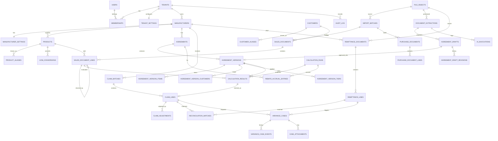

# Database Schema

> PostgreSQL 16+. Owner: `backend/migrations/` (Alembic). This document is the design; migrations are the implementation. If they diverge, **report the conflict** (see `CLAUDE.md`), do not silently change either.
> Related: `ARCHITECTURE.md` (modules), `BUSINESS_LOGIC.md` (semantics of calculation fields), `SECURITY.md` (roles, RLS).

## 1. Global conventions

| Topic | Rule |
|---|---|
| Primary keys | `id uuid` UUIDv7, generated in the application. Exception: `audit_log.id bigint identity`. |
| Tenant column | Every tenant-owned table has `tenant_id uuid NOT NULL REFERENCES tenants(id)` and `UNIQUE (tenant_id, id)`. |
| Foreign keys | Between tenant-owned tables always **composite**: `FOREIGN KEY (tenant_id, parent_id) REFERENCES parent (tenant_id, id)`. A row cannot point to another tenant's row. |
| Money | Amounts `NUMERIC(18,4)`; unit prices/costs `NUMERIC(18,6)`; quantities `NUMERIC(18,6)`; rates as fractions `NUMERIC(9,6)` (`0.025` = 2.5%); `currency_code char(3)` on monetary rows (CHECK = tenant currency, ADR-024). No `float`, `real`, `double precision`, or `money` type anywhere (CI check on migrations). |
| Timestamps | `created_at timestamptz NOT NULL DEFAULT now()`; `updated_at` only on tables that are legitimately mutable. Business dates are `date`. |
| Text | `text` with CHECK length where bounded. Case-insensitive identifiers (email) use `citext`. |
| Enumerations | `text` + `CHECK (col IN (...))` (easier to evolve than PG enums). Values listed below. |
| Naming | `snake_case`, plural table names. Constraints: `pk_<t>`, `fk_<t>_<ref>`, `uq_<t>_<cols>`, `ck_<t>_<rule>`, indexes `ix_<t>_<cols>`. |
| Soft delete | Not used for financial records. State columns instead (`status`, `released_at`, `voided_at`). |
| JSONB | Only for: rules payloads, traces, extraction results, raw source rows, audit before/after. Anything queried or constrained is a column. |
| Immutability | Enforced with triggers where stated (§7). |

## 2. Roles and tenant isolation

| DB role | Used by | Privileges |
|---|---|---|
| `rebate_owner` | Alembic migrations only | Owns all objects |
| `rebate_app` | API and worker | `SELECT/INSERT/UPDATE/DELETE` on mutable tables, `INSERT/SELECT` only on append-only tables; **no** `BYPASSRLS`, not owner |
| `rebate_ai_writer` | AI gateway sessions | `INSERT/SELECT/UPDATE(status…)` on `document_extractions`, `ai_invocations`, `agreement_drafts`, `agreement_draft_revisions`, `remittance_extraction_staging`; `SELECT` on `file_objects` (granted with the AI gateway, S6; no grant before that); nothing else |
| `rebate_readonly` | Support/debug (tenant-scoped via RLS) | `SELECT` |
| `rebate_lookup` | Owner of `fn_user_memberships` only (NOLOGIN, BYPASSRLS) | `SELECT` on `memberships`, `tenants` |

RLS pattern applied to **every** tenant table by the helper `enable_tenant_rls('table')` in `migrations/_rls.py`:

```sql
ALTER TABLE t ENABLE ROW LEVEL SECURITY;
ALTER TABLE t FORCE ROW LEVEL SECURITY;
CREATE POLICY tenant_isolation ON t
  USING      (tenant_id = NULLIF(current_setting('app.tenant_id', true), '')::uuid)
  WITH CHECK (tenant_id = NULLIF(current_setting('app.tenant_id', true), '')::uuid);
```

- `app.tenant_id` is set with `SET LOCAL` semantics (`set_config(..., true)`) at the start of each transaction (`core/db.py`). If unset, `current_setting(..., true)` is NULL, or `''` once the session has used the setting before; `NULLIF` turns both into NULL, so no rows match (fail closed, no error).
- `tenants` policy: the same expression on `id` (`enable_tenant_rls('tenants', column='id')`).
- Global tables (no RLS): `users`, `sessions`, `user_tokens`, `mfa_recovery_codes`, `pending_registrations`, `rate_limit_counters`, `reason_codes` (reference list), Procrastinate tables. `rebate_readonly` has **no** privileges on the credential tables (`users`, `sessions`, `user_tokens`, `mfa_recovery_codes`, `pending_registrations`, `rate_limit_counters`).
- Tables without an `id` column (`tenant_settings`, `idempotency_keys`, `manufacturer_settings`, `import_staged_rows`) are exempt from `UNIQUE (tenant_id, id)`; they cannot be composite-FK targets. `manufacturer_settings` is a 1:1 extension keyed by `manufacturer_id`; `import_staged_rows` is keyed by `(import_batch_id, row_number)` so the loader reads bounded primary-key ranges.
- `unmapped_entities.resolved_entity_id` has no FK: it points at a customer **or** a product (`entity_type` says which), and one column cannot reference two tables. The resolve service checks the target exists in the tenant before setting it.
- Pre-tenant lookups (login → list my workspaces) use `SECURITY DEFINER` functions (`fn_user_memberships(user_id)`), which return only that user's rows. *Correction (S1):* because RLS is **forced**, a function owned by `rebate_owner` would see no rows. The function is therefore owned by **`rebate_lookup`**, a `NOLOGIN BYPASSRLS` role created by `init-db.sh` that owns nothing else and holds only `SELECT` on `memberships` and `tenants`. The function sets `search_path = pg_catalog, public` and returns only `tenant_id, tenant_name, role, status`. `rebate_app` gets `EXECUTE` only and must not be a member of `rebate_lookup` (startup self-check).
- A CI test asserts every table with a `tenant_id` column has RLS enabled and forced, and has `UNIQUE (tenant_id, id)`.

## 3. Entity catalogue

Legend: PK primary key · FK composite `(tenant_id, x)` unless noted · `NN` not null. `tenant_id` is implied on every tenant table and not repeated.

### 3.1 Identity and tenancy

**users** (global): `id`, `email citext NN UNIQUE`, `password_hash text NN`, `full_name`, `email_verified_at`, `mfa_enabled bool NN default false`, `mfa_secret_enc bytea` (application-level encrypted), `status` (`active`,`disabled`), `failed_login_count int`, `locked_until timestamptz`, `last_login_at`, `created_at`. Added S1: `password_changed_at`, `mfa_last_used_step bigint` (TOTP replay guard), `lockout_level int NN default 0` (progressive lockout), `last_failed_at` (failures older than the 24 h decay window are forgotten, exactly like the counters for unknown emails).

**mfa_recovery_codes** (global): `id`, `user_id FK users`, `code_hash text NN`, `used_at`.

**user_tokens** (global): `id`, `user_id`, `purpose` (`email_verify`,`password_reset`,`email_change`), `token_hash text NN UNIQUE`, `new_email citext` (only for `email_change`), `expires_at NN`, `used_at`, `created_at`.

**pending_registrations** (global, added S1 review): `id`, `email citext NN` (not unique), `password_hash NN`, `full_name NN`, `workspace_name NN`, `token_hash NN UNIQUE`, `expires_at NN`, `used_at`, `created_at`. Users, tenants and memberships are created only when a pending registration's token is used, so an attacker cannot pre-register another person's address.

**rate_limit_counters** (global, added S1 D-4): `key text PK` (scope + keyed hash; never a raw email), `window_start timestamptz NN`, `count int NN`, `expires_at NN`. Rows past `expires_at` are pruned on write. Used for rate limits and for lockout of unknown emails.

**sessions** (global): `id text` (SHA-256 of opaque token) PK, `user_id`, `active_tenant_id`, `created_at`, `last_seen_at`, `idle_expires_at`, `absolute_expires_at`, `mfa_verified bool`, `ip inet`, `user_agent`, `revoked_at`. Index `(user_id)`. Added S1: `reauthenticated_at` (step-up), `mfa_failed_count int NN default 0`.

**tenants**: `id`, `name NN`, `slug UNIQUE`, `status` (`active`,`suspended`,`closed`), `created_at`.

**tenant_settings** (1:1): `tenant_id PK/FK`, `business_timezone text NN default 'America/Chicago'`, `currency_code char(3) NN default 'USD'`, `mfa_required bool NN default true`, `four_eyes_required bool NN default true`, `ai_processing_enabled bool NN default false`, `retention_years int NN default 7`, `default_claim_rounding jsonb`.
*`ai_processing_enabled` defaults to false: AI is opt-in per workspace (OD-2).*

**memberships**: `id`, `user_id FK users(id)` (global FK, single column), `role` (`admin`,`approver`,`analyst`,`viewer`), `status` (`active`,`disabled`), `invited_by`, `created_at`. `UNIQUE (tenant_id, user_id)`.

**invitations**: `id`, `email citext NN`, `role NN`, `token_hash NN UNIQUE`, `invited_by`, `expires_at NN`, `accepted_at`, `revoked_at`.

### 3.2 Audit, files, idempotency

Auth events of a known user that have no single tenant (failed login, lockout, password reset, MFA changes) are written **once per tenant where the user has an active membership** (S1 D-7). Failures for unknown emails produce no audit row; only a structured log line with a keyed hash of the email.

**audit_log** (append-only): `id bigint identity PK`, `tenant_id`, `occurred_at NN`, `actor_type` (`user`,`system`,`ai`), `actor_user_id`, `action NN` (e.g. `agreement.activated`), `entity_type NN`, `entity_id uuid`, `before jsonb`, `after jsonb`, `request_id`, `ip inet`, `user_agent`, `metadata jsonb`. Indexes `(tenant_id, entity_type, entity_id)`, `(tenant_id, occurred_at)`, `(tenant_id, actor_user_id, occurred_at)`.

**audit_seals** (S11.1, append-only like `audit_log`: trigger + no UPDATE/DELETE/TRUNCATE for `rebate_app`, RLS): `id bigint identity PK`, `tenant_id`, `from_audit_id NN`, `to_audit_id NN`, `prev_hash char(64)` (NULL for the tenant's first seal), `seal_hash char(64) NN`, `sealed_at`. UNIQUE `(tenant_id, id)`, `(tenant_id, from_audit_id)`, `(tenant_id, to_audit_id)`; no FK to `audit_log` (a later audited purge removes entries and their seals together). Canonical form and chain (`modules/audit/seal.py`): entry = UTF-8 JSON of `{id, tenant_id, occurred_at, actor_type, actor_user_id, action, entity_type, entity_id, before, after, request_id, ip, user_agent, metadata}` with sorted keys, separators `,` `:`, ids, `ip` and the jsonb columns (`before::text` etc.) as PostgreSQL text, `occurred_at` as UTC `YYYY-MM-DDTHH:MM:SS.ffffffZ`; `h = SHA-256(h || canonical_entry)` as hex, starting from the previous seal's `seal_hash` (empty for the first); `seal_hash` is the last `h` of the range. Only entries older than 5 minutes are sealed, and a run is skipped (warning `audit_seal.deferred`) while another transaction older than that is open; that check only sees `rebate_app` sessions (no `pg_read_all_stats`), so any new role writing `audit_log` needs that grant. Verification also checks that every entry up to the last seal lies in some seal's range. There is no key and the algorithm is public: anyone who can bypass the append-only trigger (the table owner or a superuser) can rewrite entries and re-seal them. Integrity is proven only back to the last seal hash kept off-box (`verify --anchor`); everything after the last anchor is tamper-evident only against people who cannot do that.

**file_objects**: `id`, `kind` (`import`,`agreement`,`remittance`,`export`,`attachment`), `original_name`, `storage_key NN`, `size_bytes NN`, `sha256 char(64) NN`, `declared_mime`, `detected_mime NN`, `scan_status` (`pending`,`clean`,`infected`,`error`), `scan_detail`, `uploaded_by NN`, `created_at`, `scanned_at` (S2). `UNIQUE (tenant_id, kind, sha256)` for kinds `import`,`remittance`,`agreement` (partial index, excluding `error` rows) to detect same-file re-upload. S2: CHECK that `storage_key` is this tenant's quarantine or clean key; trigger `fn_file_objects_identity_immutable` rejects changes to the file's identity columns, any change at all once the outcome is `clean`/`infected`, and a `storage_key` change except together with the promotion to `clean`; `rebate_app` has no DELETE/TRUNCATE. A failed-scan (`error`) row does not own its content: the same content can be uploaded again, and an admin retry of the old scan then leaves it `error` ("superseded by re-upload").

**jobs** (global, S2, ADR-005 fallback): `id`, `tenant_id` (nullable; NULL only for user-level identity emails), `kind`, `payload jsonb` (ids only, ≤ 2 KB), `status` (`queued`,`running`,`succeeded`,`failed`), `attempts`, `max_attempts`, `run_at`, `locked_until`, `last_error` (exception class or our own message, ≤ 500 chars), `dedupe_key UNIQUE` (forever, across tenants and statuses: keys embed a globally unique id, e.g. `files_scan:{file_id}`), `created_by`, `created_at`, `updated_at`, `finished_at`. No RLS by design (the worker claims across tenants); every API read filters `tenant_id` explicitly and the route isolation suite covers it; the schema lint lists it as a documented global table. `CHECK (attempts <= max_attempts)`. `rebate_readonly` has no access; `rebate_app` has no DELETE/TRUNCATE (dead letters are evidence). Retention of finished jobs: not purged yet (sweep with S9 operations).

**password_reset_requests** (global, S2): `id`, `email citext`, `created_at`. The forgot-password job payload carries this id; the job deletes the row, and its dead-letter hook deletes it too, so a typed address is never kept once no email will be sent.

S2 token decision: `pending_registrations.token_hash`, `user_tokens.token_hash` and `invitations.token_hash` are nullable; the email job mints the token, stores only its hash and sends the link in one transaction.

**idempotency_keys**: `tenant_id`, `key text`, `endpoint`, `request_hash`, `response_status`, `response_body jsonb`, `created_at`, `expires_at`. PK `(tenant_id, key, endpoint)`.

### 3.3 Master data

**manufacturers**: `id`, `name NN`, `code NN`, `external_id`, `active`. `UNIQUE (tenant_id, code)`.

**manufacturer_settings** (1:1): `manufacturer_id PK/FK`, `claim_window_days int`, `claim_window_basis` (`invoice_date`,`ship_date`,`month_end` for SPA lines,`period_end` for rebates only), `dispute_window_days int`, `dispute_window_basis` (`remittance_date`,`submission_date`), `allow_negative_claims bool NN default false`, `conflict_policy` (`flag`,`priority`) NN default `flag`, `variance_tolerance NUMERIC(18,4) NN default 0.01`, `payment_lag_days_expected int`, `notes`.

**reason_codes** (global reference, seeded): `code PK`, `label`, `category`, `description`. Values in `BUSINESS_LOGIC.md` §11–§12.

**reason_code_mappings**: `id`, `manufacturer_id`, `external_code NN`, `external_text`, `reason_code FK reason_codes`. `UNIQUE (tenant_id, manufacturer_id, external_code)`.

**customers**: `id`, `name NN`, `code`, `external_id`, `customer_type` (`contractor`,`end_user`,`branch`,`other`), `parent_customer_id FK customers`, `active`. `UNIQUE (tenant_id, code)` where code not null. Trigram index on `name`.

**customer_aliases**: `id`, `customer_id`, `alias NN`, `source`. `UNIQUE (tenant_id, lower(alias))`.

**branches**: `id`, `name NN`, `code NN`. `UNIQUE (tenant_id, code)`.

**products**: `id`, `sku NN`, `description`, `manufacturer_id NN`, `manufacturer_part_number`, `base_uom NN`, `category`, `active`. `UNIQUE (tenant_id, sku)`. Indexes `(tenant_id, manufacturer_id)`, trigram on `sku`.

**product_aliases**: `id`, `product_id`, `alias NN`, `alias_type` (`erp_sku`,`manufacturer_part`,`upc`,`other`). `UNIQUE (tenant_id, alias_type, alias)`.

**uom_conversions**: `id`, `product_id` (nullable = tenant default), `from_uom NN`, `to_uom NN`, `factor NUMERIC(18,8) NN CHECK (factor > 0)`. `UNIQUE (tenant_id, product_id, from_uom, to_uom)`.

### 3.4 Import pipeline

**mapping_templates**: `id`, `name NN`, `import_type NN` (`sales`,`purchases`,`customers`,`products`,`uom`,`agreement_items`,`remittance`), `header_signature NN` (hash of normalised header names), `mapping jsonb NN` (canonical field → source column + transform), `options jsonb` (delimiter, decimal separator, date format, encoding, header row, sheet), `version int`, `created_by`, `created_at`. `UNIQUE (tenant_id, name)`; index `(tenant_id, import_type, header_signature)`.

**import_batches**: `id`, `import_type NN`, `file_id NN FK file_objects`, `mapping_template_id`, `source_system text NN`, `status NN` (`uploaded`,`scanning`,`parsing`,`awaiting_confirmation`,`loading`,`completed`,`completed_with_errors`,`failed`,`rejected`), `accept_partial bool default false`, `counts jsonb` (`rows_total, inserted, unchanged, changed, rejected`), `error_summary`, `checkpoint jsonb`, `created_by`, `created_at`, `started_at`, `completed_at`.

**import_staged_rows**: `import_batch_id`, `row_number int NN`, `raw jsonb NN`, `normalized jsonb`, `status` (`valid`,`error`,`duplicate`,`changed`). PK `(import_batch_id, row_number)`. Purged after configurable retention (raw file remains in object storage).

**import_row_errors**: `id`, `import_batch_id`, `row_number`, `column_name`, `code NN`, `message NN`, `raw jsonb`. Index `(import_batch_id)`.

### 3.5 Source transactions (append-only versions)

**sales_documents**: `id`, `import_batch_id NN`, `source_system NN`, `doc_type NN` (`invoice`,`credit_note`), `document_number NN`, `document_date NN date`, `ship_date date`, `customer_id NN`, `branch_id`, `original_document_id FK sales_documents` (credit notes), `currency_code`, `row_hash NN`, `version int NN default 1`, `is_current bool NN default true`, `superseded_by_id`, `created_at`.
Unique: `(tenant_id, source_system, doc_type, document_number) WHERE is_current`.

**sales_document_lines**: `id`, `document_id NN`, `import_batch_id NN`, `source_row_number NN`, `source_system NN`, `document_number NN` (denormalised), `line_number NN`, `product_id`, `sku_raw NN`, `manufacturer_id`, `customer_id NN` (denormalised), `description`, `quantity NUMERIC(18,6) NN CHECK (quantity <> 0)`, `uom NN`, `unit_price NUMERIC(18,6) NN`, `unit_cost NUMERIC(18,6)`, `replacement_cost NUMERIC(18,6)`, `extended_amount NUMERIC(18,4) NN`, `invoice_date NN date` (denormalised), `ship_date date`, `spa_reference text`, `project_reference text`, `original_line_id FK sales_document_lines` (returns), `row_hash NN`, `version int NN default 1`, `is_current bool NN default true`, `superseded_by_id`, `created_at`.
Unique: `(tenant_id, source_system, document_number, line_number) WHERE is_current`.
Indexes: `(tenant_id, manufacturer_id, invoice_date) WHERE is_current`, `(tenant_id, customer_id, invoice_date)`, `(tenant_id, product_id)`, `(tenant_id, spa_reference) WHERE spa_reference IS NOT NULL`, `(tenant_id, original_line_id)`.
Checks: lines carry a denormalised `doc_type` (`invoice`,`credit_note`) and `CHECK ((doc_type = 'invoice' AND quantity > 0) OR (doc_type = 'credit_note' AND quantity < 0))`. The normaliser **canonicalises credit-note/return quantities to negative** whatever sign the source file uses. Price-only credit notes (quantity 0) are not supported in Release 1 and are rejected with a row error. (Rule in `BUSINESS_LOGIC.md` §7.)

**purchase_documents**: `id`, `import_batch_id`, `source_system`, `doc_type` (`receipt`,`vendor_credit`), `document_number NN`, `document_date NN`, `manufacturer_id NN`, `po_number`, `currency_code`, `row_hash`, `version`, `is_current`, `superseded_by_id`. Unique as sales.

**purchase_document_lines**: `id`, `document_id`, `import_batch_id`, `source_row_number`, `line_number`, `product_id`, `sku_raw`, `manufacturer_id`, `quantity`, `uom`, `unit_cost`, `extended_amount`, `document_date` (denormalised), `row_hash`, `version`, `is_current`, `superseded_by_id`. Index `(tenant_id, manufacturer_id, document_date) WHERE is_current`.

### 3.6 Agreements

**agreements**: `id`, `manufacturer_id NN`, `agreement_type NN` (`spa`,`rebate`), `external_number NN`, `name NN`, `cancelled_at`, `created_by`, `created_at`. `UNIQUE (tenant_id, manufacturer_id, external_number)`.

**agreement_versions** (immutable once `active`): 
`id`, `agreement_id NN`, `version_number int NN`, `status NN` (`active`,`superseded`,`expired`,`cancelled`), `valid_from date NN`, `valid_to date NN`, `valid_range daterange GENERATED ALWAYS AS (daterange(valid_from, valid_to, '[]')) STORED`, `rules jsonb NN`, `rules_schema_version int NN`, `priority int NN default 0`, `source NN` (`manual`,`spreadsheet_template`,`ai_extraction`), `draft_id`, `source_file_id`, `derived_from_version_id` (split copies), `supersedes_version_id`, `superseded_by_version_id`, `content_hash NN` (hash of canonical terms incl. items/customers/tiers), `created_by NN`, `approved_by NN`, `activated_at NN`, `superseded_at`.
Constraints: `CHECK (valid_to >= valid_from)`; `UNIQUE (tenant_id, agreement_id, version_number)`; **`EXCLUDE USING gist (tenant_id WITH =, agreement_id WITH =, valid_range WITH &&) WHERE (status = 'active')`**.
Only versions that passed approval exist in this table. Drafts live in `agreement_drafts` (a version row is never created in an unapproved state).
*Implementation (S4, migration `20261112_0900_agreements`):* the exclusion constraint is `ex_agreement_versions_no_overlap … WHERE (status IN ('active','expired'))` (expired versions still govern their period, so S5 loaders read active **and** expired versions); `created_txid bigint NN` (forced by a BEFORE INSERT trigger to the inserting transaction id) lets the child-table trigger refuse terms added after approval; a version is inserted only as `active` or `expired`; `CHECK ((status = 'superseded') = (superseded_at IS NOT NULL))`. Status transitions allowed by the trigger: `active → superseded/expired/cancelled`, `expired → superseded/cancelled`; `superseded_at` and `superseded_by_version_id` are set once. `rebate_app` holds UPDATE only on `(status, superseded_at, superseded_by_version_id)` and no DELETE. `content_hash` = SHA-256 of the canonical terms (type, priority, rules, items by product, customers, tiers), validity excluded, so split copies share it. `agreement_version_items.customer_id` is always NULL in Release 1 (the payload/engine item has no customer); `agreement_version_tiers.flat_amount` is never written (the engine `Tier` has no flat amount); the unique key on items is `UNIQUE NULLS NOT DISTINCT (tenant_id, version_id, product_id, customer_id)` (`uq_agreement_version_items_version_product_customer`), equivalent to the coalesce form. *Backup note:* `created_txid` holds source-cluster transaction ids. A full logical restore is safe because `pg_dump` creates triggers in post-data, after the rows are loaded, so restored values are kept; restored versions cannot gain children except, in principle, from a later transaction whose id happens to equal a restored value (the new cluster's counter may reach them). A `--data-only` restore into an existing schema fires the triggers: the BEFORE INSERT trigger rewrites `created_txid` and the child trigger then refuses the item/customer/tier rows, so restore data-only with `--disable-triggers` (needs a superuser); `--single-transaction` alone is not enough, since the insert trigger also refuses restored `superseded`/`cancelled` versions. Physical backup/PITR keeps txids consistent.

**agreement_version_items** (SPA SKU lines): `id`, `version_id NN`, `line_number`, `product_id NN`, `customer_id` (item-level restriction, nullable), `reference_cost NUMERIC(18,6)`, `deviated_cost NUMERIC(18,6)`, `sell_price NUMERIC(18,6)`, `flat_amount NUMERIC(18,6)`, `rate NUMERIC(9,6)`, `claim_uom`, `max_quantity NUMERIC(18,6)`. Indexes `(tenant_id, version_id)`, `(tenant_id, product_id)`. `UNIQUE (tenant_id, version_id, product_id, coalesce(customer_id, '00000000-0000-0000-0000-000000000000'))`.

**agreement_version_customers**: `version_id`, `customer_id`, `scope` (`include`,`exclude`). PK `(version_id, customer_id)` (no `id`: exempt from `UNIQUE (tenant_id, id)`).

**agreement_version_tiers**: `id`, `version_id`, `tier_number int NN`, `lower_bound NUMERIC(18,2) NN`, `rate NUMERIC(9,6)`, `flat_amount NUMERIC(18,4)`. `UNIQUE (tenant_id, version_id, tier_number)`. Validator (not just DB) enforces strictly increasing `lower_bound` with tier 1 = 0.

**agreement_drafts**: `id`, `agreement_id` (null = brand-new agreement), `amends_version_id`, `source NN`, `status NN` (`draft`,`pending_approval`,`approved`,`rejected`,`needs_manual_entry`,`cancelled`), `payload jsonb NN` (the complete structured agreement: header, rules, items, customers, tiers), `payload_schema_version int NN`, `revision int NN default 1`, `validation jsonb` (errors/warnings from the last validator run), `extraction_id`, `source_file_id`, `created_by NN`, `submitted_by`, `submitted_at`, `reviewed_by`, `reviewed_at`, `rejection_reason`, `resulting_version_id`.

*Implementation (S4):* also `review_comment` (return comment shown to the analyst), `created_at`, `updated_at`; `extraction_id` has no FK until `document_extractions` exists (S6). CHECKs: payload is a JSON object, `(status = 'approved') = (resulting_version_id IS NOT NULL)`, rejected ⇒ `rejection_reason`, `amends_version_id` ⇒ `agreement_id`. No DELETE for `rebate_app` (agreements neither). A draft is stored even when its payload does not validate (work in progress); `validation` holds the last validator result.

**agreement_draft_revisions**: `id`, `draft_id`, `revision`, `payload jsonb`, `edited_by`, `created_at`, `change_summary`. Append-only.

**document_extractions**: `id`, `file_id NN`, `kind NN` (`agreement`,`remittance`,`mapping`), `status NN` (`queued`,`processing`,`completed`,`needs_manual_entry`,`failed`), `text_method` (`native`,`ocr`,`none`), `pass_results jsonb`, `result jsonb`, `evidence_check jsonb`, `validation jsonb`, `confidence NUMERIC(4,3)`, `model`, `prompt_version`, `error_code`, `error_detail`, `created_by`, `created_at`, `completed_at`.

**ai_invocations**: `id`, `extraction_id`, `purpose NN`, `provider NN`, `model NN`, `prompt_version NN`, `input_sha256`, `input_tokens`, `output_tokens`, `cost_usd NUMERIC(12,6)`, `latency_ms`, `status NN`, `error_code`, `created_at`. Raw prompts/responses are **not** stored here (the extraction `result` and `pass_results` hold what is needed).

**remittance_extraction_staging**: `id`, `extraction_id`, `remittance_document_id`, `payload jsonb`, `arithmetic_check jsonb`, `status` (`pending_review`,`confirmed`,`rejected`).

### 3.7 Calculation

**calculation_runs**: `id`, `scope_hash NN` (unique per tenant while `queued`/`running`: one active run per scope), `run_date date NN` (business date the run was created: claim-window gate; `as_of` only pins agreement-version visibility), `scope jsonb NN` (`manufacturer_ids`, `date_from`, `date_to`, filters), `as_of timestamptz NN` (agreement-version visibility instant), `data_cutoff timestamptz NN` (import state instant), `engine_version NN`, `config_hash NN`, `agreement_version_ids uuid[] NN`, `input_checksum`, `status NN` (`queued`,`running`,`completed`,`failed`,`cancelled`), `totals jsonb`, `error`, `created_by`, `created_at`, `started_at`, `completed_at`.

**calculation_results** (append-only; about 1.6 KB per row with the denormalised columns and trace, 2.3 GB per 1M lines, see `reports/PERFORMANCE_BASELINES.md`): `id`, `run_id NN`, `sales_document_line_id NN`, `agreement_version_id`, `status NN` (`eligible`,`exception`,`netted`,`adjustment`,`not_applicable`), `exception_code`, `excess_quantity NUMERIC(18,6)`, `flags text[]`, `document_number`, `line_number`, `invoice_date`, `manufacturer_id`, `agreement_id` (denormalised from the line/version so lists need no join into other modules), `eligible_quantity NUMERIC(18,6)`, `claim_uom`, `claim_unit_amount NUMERIC(18,6)`, `claim_amount NUMERIC(18,4) NN default 0`, `trace jsonb NN`, `inputs_hash NN`, `created_at`. `UNIQUE (tenant_id, run_id, sales_document_line_id)`. Indexes `(tenant_id, run_id, status, id)`, `(tenant_id, run_id, id)`, `(tenant_id, sales_document_line_id)`.

**rebate_accrual_entries** (append-only ledger): `id`, `run_id NN`, `agreement_id NN`, `agreement_version_id NN`, `period_start NN`, `period_end NN`, `as_of_date NN`, `cumulative_qualifying NUMERIC(18,4)`, `cumulative_payout_base NUMERIC(18,4)`, `tier_number`, `tier_rate NUMERIC(9,6)`, `cumulative_earned NUMERIC(18,4)`, `prior_cumulative_accrued NUMERIC(18,4)`, `delta NUMERIC(18,4) NN`, `claim_deadline date` (period end + `claim_window_days`), `flags text[]`, `manufacturer_id`, `external_number`, `agreement_name`, `tiers jsonb` (terms snapshot), `inputs_hash NN`, `trace jsonb NN`, `created_at`. `UNIQUE (tenant_id, run_id, agreement_id, period_start)`.

### 3.8 Claims

**claim_export_templates**: `id`, `manufacturer_id`, `name`, `format` (`csv`,`xlsx`), `columns jsonb NN` (ordered: header, source field, format, constant), `options jsonb`, `active`.

**claim_batches**: `id`, `manufacturer_id NN`, `batch_number NN`, `status NN` (`draft`,`approved`,`submitted`,`void`), `period_from`, `period_to`, `line_count int`, `total_amount NUMERIC(18,4)`, `export_template_id`, `exported_file_id`, `submitted_at`, `submitted_by`, `external_reference`, `created_by NN`, `approved_by`, `approved_at`, `void_reason`, `voided_at`. `UNIQUE (tenant_id, batch_number)`.

**claim_lines**: `id`, `batch_id NN`, `claim_reference text NN` (human/export key, e.g. `CL-2026-000123`), `source_kind NN` (`sales_line`,`rebate_accrual`), `sales_document_line_id`, `rebate_accrual_entry_id`, `calculation_result_id` (NULL exactly for `source_kind='rebate_accrual'`), `agreement_version_id NN`, `quantity NUMERIC(18,6)`, `unit_amount NUMERIC(18,6)`, `claim_amount NUMERIC(18,4) NN`, `frozen_at`, `released_at`, `created_at`.
Constraints: `CHECK ((source_kind='sales_line') = (calculation_result_id IS NOT NULL))` (a rebate claim line has an accrual entry and no calculation result; orchestrator decision, S7.4), `CHECK ((source_kind='sales_line') = (sales_document_line_id IS NOT NULL))`, `CHECK ((source_kind='rebate_accrual') = (rebate_accrual_entry_id IS NOT NULL))`; `UNIQUE (tenant_id, claim_reference)`; **partial unique** `(tenant_id, sales_document_line_id) WHERE released_at IS NULL` and `(tenant_id, rebate_accrual_entry_id) WHERE released_at IS NULL` (a source can be actively claimed once). `released_at` is set only when a *draft/approved* batch is voided.

**claim_adjustments**: `id`, `run_id` (nullable: the run that proposed it; `variance_case_id` carries no FK until S9; `claim_line_id` and `rebate_accrual_entry_id` have composite FKs since S7.4), `manufacturer_id NN`, `adjustment_type NN` (`return_reversal`,`agreement_change`,`manual_correction`,`rebate_clawback`,`recovery_reclaim`), `claim_line_id`, `rebate_accrual_entry_id`, `calculation_result_id`, `variance_case_id`, `amount NUMERIC(18,4) NN` (signed), `reason NN`, `status NN` (`proposed`,`approved`,`included`,`rejected`), `included_in_batch_id`, `proposed_by`, `approved_by`, `approved_at`, `created_at`.
Constraints (S7.4): `rebate_accrual_entry_id` is set exactly for `rebate_clawback`, whose amount is negative; `return_reversal` and `agreement_change` name their `claim_line_id`; a new row is always `proposed`, unapproved and unattached (insert trigger); `status='included'` exactly when `included_in_batch_id` is set; `approved`/`included` carry `approved_by`+`approved_at`, `proposed` carries neither; one clawback per accrual entry; one proposal per (claim line, type, run, result). Trigger: `included` only from `approved`, only into a `draft` batch of the same manufacturer, and back to `approved` only when that batch is `void`; amount, type, links and reason never change; no delete. The batch total (deferred trigger) is the lines plus the signed adjustments included in it; `line_count` counts lines only.

### 3.9 Remittance and reconciliation

**remittance_documents**: `id`, `manufacturer_id NN`, `file_id NN`, `doc_type NN` (`credit_memo`,`remittance_advice`,`deduction_notice`), `channel NN` (`credit_memo`,`check`,`ach`,`deduction`), `document_number`, `document_date`, `payment_date`, `total_amount NUMERIC(18,4) NN`, `currency_code`, `status NN` (`uploaded`,`pending_review`,`accepted`,`reconciled`,`void`), `extraction_id`, `import_batch_id`, `accepted_by`, `accepted_at`, `created_by`, `created_at`. Partial unique `(tenant_id, manufacturer_id, document_number) WHERE status <> 'void' AND document_number IS NOT NULL`.

**remittance_lines**: `id`, `remittance_document_id NN`, `line_number NN`, `source_row_number`, `claim_reference`, `invoice_number`, `invoice_line_number`, `sku_raw`, `customer_ref`, `quantity`, `amount_paid NUMERIC(18,4) NN`, `amount_claimed_stated NUMERIC(18,4)`, `external_reason_code`, `external_reason_text`, `reason_code` (mapped), `raw jsonb`, `category` (`unmatched_payment`, final: the line can no longer be matched, also enforced by trigger (migration `20261118_0910_recon_guards`); set once while the document is `accepted` and the line has no confirmed match), `categorised_by`, `categorised_at` (migration `20261118_0900_recon_categorise`; nothing else on a line ever changes). `UNIQUE (tenant_id, remittance_document_id, line_number)`. Indexes on `claim_reference`, `(invoice_number, invoice_line_number)`.

**reconciliation_matches**: `id`, `remittance_line_id NN`, `claim_line_id`, `claim_adjustment_id`, `allocated_amount NUMERIC(18,4) NN`, `method NN` (`exact_reference`,`invoice_line`,`composite`,`fuzzy`,`subset_sum`,`manual`), `score NUMERIC(5,4)`, `evidence jsonb NN` (fields compared and how), `status NN` (`suggested`,`confirmed`,`rejected`), `matched_by_run_id`, `confirmed_by`, `confirmed_at`, `created_at`. `CHECK (num_nonnulls(claim_line_id, claim_adjustment_id) = 1)`. Invariant (service and deferred trigger `fn_reconciliation_match_within_paid`, migration `20261118_0910_recon_guards`, which locks the remittance line `FOR UPDATE` to serialise concurrent transactions): confirmed allocations per remittance line sum to ≤ `amount_paid`, where an allocation to an adjustment carried by another batch counts as `max(amount, 0)` and one to a same-batch adjustment must equal the adjustment's amount exactly; a `confirmed` match on a categorised line is refused by the insert/change triggers; per claim line sum of confirmed allocations is tracked against `claim_amount`. Index on `(tenant_id, claim_line_id)`, `(tenant_id, remittance_line_id)`.

### 3.10 Recovery

**variance_cases**: `id`, `manufacturer_id NN`, `claim_line_id`, `remittance_line_id`, `case_type NN` (`short_paid`,`rejected`,`unpaid`,`overpaid`,`unmatched_payment`,`source_changed`), `reason_code NN FK reason_codes`, `claimed_amount NUMERIC(18,4)`, `paid_amount NUMERIC(18,4)`, `variance_amount NUMERIC(18,4) NN`, `deadline_date date`, `deadline_basis`, `owner_user_id`, `status NN` (`open`,`to_reclaim`,`submitted`,`recovered`,`written_off`,`closed_no_action`), `recovered_amount NUMERIC(18,4) default 0`, `written_off_amount NUMERIC(18,4) default 0`, `dispute_assessment jsonb`, `remittance_document_id` (the finalised remittance that opened the case; replaces `created_by_run_id`), `external_reason_code`, `revision int NN` (If-Match; every update bumps it by one), write-off columns `write_off_proposed_by/_at`, `write_off_reason`, `written_off_by/_at`, `created_by`, `created_at`, `closed_at`.

`deadline_unknown` is **not** a case type (BUSINESS_LOGIC §12 calls it a flag): it is `deadline_date IS NULL` (and then `deadline_basis IS NULL`; basis is `remittance_date` or `submission_date`). Invariants in the database: the state edges of §12.1 (closed cases never change), identity/amount/link columns fixed, `recovered_amount` never decreases, `recovered` only when recovered >= variance, `written_off` only with `written_off_by`/`_at` and `written_off_amount = variance_amount - recovered_amount`, the write-off approver differs from the proposer (four-eyes), no DELETE. A four-eyes proposal is voided by the service on any recovery or status change.
Partial unique `(tenant_id, claim_line_id, case_type) WHERE status NOT IN ('recovered','written_off','closed_no_action')` (one live case per claim line and type). Index `(tenant_id, status, deadline_date)`.

**variance_case_events** (append-only): `id`, `case_id NN`, `event_type NN` (`created`,`status_changed`,`note`,`assigned`,`attachment`,`amount_recovered`,`assessment_updated`,`write_off_proposed`,`reclaim_proposed`), `from_status`, `to_status`, `note`, `payload jsonb`, `actor_user_id`, `created_at`.

**case_attachments** (append-only): `case_id`, `file_id`, `added_by`, `added_at`; the file must be a clean-scanned `attachment`; `UNIQUE (tenant_id, case_id, file_id)`.

**notifications**: `id`, `user_id NN`, `kind NN`, `entity_type`, `entity_id`, `title NN`, `body`, `due_date`, `dedupe_key NN`, `read_at`, `emailed_at`, `created_at`. `UNIQUE (tenant_id, user_id, dedupe_key)`. `kind` is `deadline_reminder`; only `read_at` and `emailed_at` can be updated, each once. `claim_adjustments.variance_case_id` references `variance_cases` (composite FK); a `recovery_reclaim` adjustment always has a case, a positive amount, and at most one is proposed/approved per case.

### 3.11 Reporting

**summary_claims_monthly** (refreshed by job): `manufacturer_id`, `branch_id` (nullable), `month date`, `claimed`, `collected`, `short_paid`, `recovered`, `written_off`, `at_risk`, `refreshed_at`. PK `(tenant_id, manufacturer_id, coalesce(branch_id,…), month)`. Never the source of truth; every figure is reproducible by query (tested). *Implementation (S10):* extra columns `id` (tenant-table convention), `recovered_after_write_off` (D-N5), `expiring` and `as_of_date` (the business date `at_risk`/`expiring` were computed for); the natural key is the unique index `(tenant_id, manufacturer_id, coalesce(branch_id, zero uuid), month)`. Rebuilt per tenant in one transaction by the `refresh_summaries` job. Figure definitions: BUSINESS_LOGIC §12.2.

## 4. ER diagram



## 5. Duplicate-import prevention (three layers)

1. **File level:** `file_objects (tenant_id, kind, sha256)` partial unique index → uploading the identical file returns the existing import ("already imported on …").
2. **Natural key per row:** `(tenant_id, source_system, document_number, line_number) WHERE is_current` unique index. Loading uses `INSERT … ON CONFLICT` logic implemented in the repository, never blind inserts.
3. **Row content hash:** `row_hash = SHA-256(canonical JSON of normalised fields)`. For an existing key:
   - same hash → **unchanged** (no-op, counted);
   - different hash → insert new row `version = old + 1`, set old `is_current = false`, `superseded_by_id = new.id`; record as **changed** in the batch summary; if the old row is referenced by any non-released `claim_line`, create a `variance_cases` row of type `source_changed` and block silent propagation.

Imports are chunked, each chunk one transaction, with `import_batches.checkpoint` allowing resume. Order independence is a tested property.

## 6. Traceability

```
file_objects ← import_batches ← sales_document_lines (import_batch_id, source_row_number)
sales_document_lines ← calculation_results (run_id, agreement_version_id, trace, engine_version via run)
calculation_results ← claim_lines (calculation_result_id) → claim_batches
claim_lines ← reconciliation_matches → remittance_lines → remittance_documents → file_objects
claim_lines/remittance_lines ← variance_cases ← variance_case_events
agreement_versions ← agreement_drafts ← document_extractions ← file_objects
```

Every amount in an API response that is computed or stored carries (or can be resolved by) a `trace_ref` = `{kind, id}` pointing at the `calculation_result`, `rebate_accrual_entry`, or `reconciliation_match` row. `GET /trace/...` resolves the chain in one call (see `API_SPECIFICATION.md`).

## 7. Immutability and integrity triggers

| Rule | Mechanism |
|---|---|
| `audit_log` no UPDATE/DELETE | `BEFORE UPDATE OR DELETE` trigger raises; `rebate_app` lacks the privileges anyway |
| `calculation_results`, `rebate_accrual_entries`, `agreement_draft_revisions`, `variance_case_events` append-only | trigger raises on UPDATE/DELETE |
| `agreement_versions` terms immutable | trigger rejects UPDATE of any column except `status`, `superseded_at`, `superseded_by_version_id` |
| `agreement_version_items/customers/tiers` immutable | append-only (`fn_forbid_mutation`, no UPDATE/DELETE grant) and a BEFORE INSERT trigger: rows can be added only by the transaction that created the parent version (`created_txid`), so approved terms can neither change nor grow (S4) |
| `claim_lines` frozen after submission | trigger: when `frozen_at IS NOT NULL`, reject UPDATE/DELETE. `released_at` may be set only if parent batch `status IN ('draft','approved','void')` |
| `claim_batches` | status transitions validated by trigger (`draft→approved→submitted`, `draft/approved→void`); `submitted` rows immutable except `external_reference` notes via audited update |
| Source lines | only `is_current`, `superseded_by_id` may change; trigger rejects other updates |
| Money sanity | CHECKs: amounts finite, `rate BETWEEN 0 AND 1` (rates above 100% rejected), `allocated_amount <> 0` |
| Cross-tenant | composite FKs; isolation test suite |

## 8. Transaction management

- One API request = one transaction; `SET LOCAL app.tenant_id` first.
- **Calculation run:** takes `pg_advisory_xact_lock(hashtext(tenant_id::text || scope_key))`; writes results in chunks; run row is `completed` only when all chunks succeed. Readers only use results whose run is `completed`.
- **Batch submission:** single transaction: set `frozen_at` on all lines, set batch `submitted`, audit entry.
- **Agreement activation:** single transaction including split-supersede, exclusion-constraint check, audit.
- Isolation level `READ COMMITTED` with explicit `SELECT … FOR UPDATE` on rows being transitioned. Use `SERIALIZABLE` only where a documented invariant needs it (none required initially).

## 9. Indexing and scale

Expected: 1–10M sales lines/year/tenant. Indexes lead with `tenant_id`. Partition `sales_document_lines` and `calculation_results` by `tenant_id` hash or by date **only after** measurements in S11 show need. Use `COPY`/bulk upserts for imports, keyset pagination for lists, and `EXPLAIN` checks recorded for the main queries (S11).

## 10. Migration strategy

- Alembic in `backend/migrations`, one revision per logical change, human-readable `message`, never edited after merge to a shared branch.
- Revision naming: `YYYYMMDD_HHMM_<slug>`. A `downgrade` is **optional** and only written when safe; production is forward-only (restore from backup is the rollback).
- Expand → migrate → contract for breaking changes (add nullable column, backfill, switch code, then constrain/drop in a later release).
- Helpers in `migrations/_rls.py` (enable RLS), `_immutable.py` (append-only trigger via `fn_forbid_mutation()` plus revoking UPDATE/DELETE/TRUNCATE from `rebate_app`), `_audit.py` (added in S1 with `audit_log`).
- CI: (1) `alembic upgrade head` on empty DB; (2) schema-drift check (`alembic check` / compare metadata); (3) lint: no float types, every tenant table has RLS + composite unique, every FK between tenant tables is composite; (4) migration on a seeded realistic dataset from `testdata/`.
- Extensions (`btree_gist`, `pg_trgm`, `citext`) are created by `init-db.sh` **and** by the baseline migration (`IF NOT EXISTS`; all three are trusted extensions), so migrations also work on managed Postgres.
- Seed data (reference `reason_codes`, roles) is applied by migrations (idempotent), not by app startup.
- Local DB: created from scratch by `infra/scripts/init-db.sh` (creates roles, database, extensions) followed by `alembic upgrade head`. See `DEPLOYMENT.md`.
