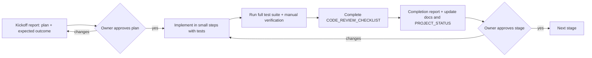
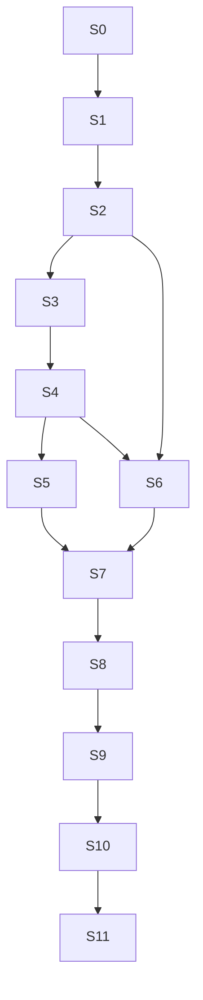

# Development Roadmap

> Scope: **Release 1** (Stages S0–S11): a production-ready core, not a demo. Release 2 items are listed at the end and are **not approved for implementation**. Task-level checklists: `IMPLEMENTATION_PLAN.md`. Live status: `PROJECT_STATUS.md`. Gate: `CODE_REVIEW_CHECKLIST.md`.
> Sizes are relative effort (S/M/L/XL), not calendar promises. Estimates will be refined at each stage kickoff.

## 1. Delivery process (applies to every stage; ADR-021)

**Kickoff report** (before coding a stage): objectives, task list, files/modules to create, DB changes, risks and open questions, test plan, expected demonstrable outcome. **Completion report:** what was built (vs plan), test results (counts, coverage), manual verification performed, deviations from docs and why, docs updated, known issues, decisions needed, readiness of the next stage. No stage may start before the previous one is approved. Within a stage, work in small commits/steps (≤ one feature slice at a time), each with tests.

## 2. Stage dependency graph

## 3. Stages

### S0 Foundation and tooling — size M
- **Objectives:** a repository that builds, lints, type-checks, tests, and runs locally in one command; module boundaries enforced from the first commit.
- **Features:** none user-facing beyond a health endpoint and an empty SPA shell.
- **Backend:** project skeleton (`backend/`), `core/` (config, db session with tenant context hook, errors, logging, clock, ids), FastAPI app factory, Alembic setup, `import-linter` contracts, test harness with Postgres, base CI config.
- **Frontend:** Vite + React + TS shell, routing, API client generation pipeline, layout, theme, error boundary.
- **Database:** `infra/scripts/init-db.sh` (roles, extensions), baseline migration (extensions, helper functions for RLS/immutability triggers), migration lint tests.
- **Infra:** Docker Compose dev stack, Dockerfiles, Makefile, `.env.example`, pre-commit.
- **Dependencies:** none.
- **Testing:** smoke tests; migration from empty; lint gates; schema-lint tests (float ban, RLS meta-test scaffolding).
- **Definition of Done:** `make up && make db-init && make migrate && make test` passes on a clean machine; CI green; `import-linter` fails on a deliberate violation; docs `README.md` run instructions verified.

### S1 Identity, tenancy, RBAC, audit — size L
- **Objectives:** secure multi-tenant foundation (FR-ID-*, FR-AU-*, NFR-03).
- **Features:** register, verify email, login, MFA, sessions, password reset, invitations, roles, user admin, workspace settings, audit log (write + search UI).
- **Backend:** `identity`, `tenancy`, `audit` modules; session middleware; CSRF; rate limiting; policy layer with route-permission declaration check; four-eyes helper; email sending via job (Mailpit locally).
- **Frontend:** auth screens, MFA enrolment, workspace switcher, Users/Invitations/Settings pages, Audit log viewer, permission-aware navigation.
- **Database:** `users`, `sessions`, `user_tokens`, `mfa_recovery_codes`, `tenants`, `tenant_settings`, `memberships`, `invitations`, `audit_log`, `idempotency_keys`; RLS on tenant tables; `fn_user_memberships`; app-role privileges; audit immutability triggers.
- **Dependencies:** S0.
- **Testing:** auth/session/CSRF/lockout tests; role × route matrix; **isolation suite v1** (running from now on); RLS/pool tests; audit immutability; e2e W1–W2.
- **DoD:** two workspaces fully isolated by tests; every route has declared permission; admin can invite/role users; audit entries for all auth/admin actions; startup self-check blocks owner/superuser connections.

### S2 Files, scanning, background jobs — size M
- **Objectives:** safe upload pipeline and a reliable job system (FR-FI-*, ARCHITECTURE §6).
- **Features:** upload files, scan status, download via presigned URL; admin jobs view with retry.
- **Backend:** `files` module (S3 client, quarantine, hashing, magic-byte checks, ClamAV), job runner (Procrastinate spike → decision recorded in ADR-005), `core/jobs.py` interface, tenant-context propagation in jobs, periodic task scaffolding, retry/dead-letter policy.
- **Frontend:** upload component (progress, status polling), Jobs admin page.
- **Database:** `file_objects`; Procrastinate schema (migrated through Alembic); job helper tables if fallback queue chosen.
- **Dependencies:** S1.
- **Testing:** EICAR, renamed/forged files, size limits, zip bomb guard, quarantine → clean flow; job idempotency, retry, dead-letter, tenant-context loss test; cross-tenant file access tests.
- **DoD:** uploads end in `clean` or `infected`; nothing reads an unscanned file; failed jobs visible and retryable; isolation suite extended to files/jobs.

### S3 Master data and import pipeline — size XL
- **Objectives:** real customer exports load correctly, traceably, and repeatably (FR-IM-*, NFR-01).
- **Features:** manufacturers (+settings), customers, products (+aliases), UoM conversions, branches; imports for sales, purchases, master data; mapping templates; error reports; change detection; unmapped-entity queue; sales/purchase line browser.
- **Backend:** `masterdata`, `ingestion` (string-safe CSV/XLSX readers, normalisers for dates/numbers/locales/UoM/sign rules, validation, staging, chunked loader with `ON CONFLICT` + row hash, resumable), optional AI mapping suggestion hook (stub returns "AI disabled" until S6; **no fake suggestions**).
- **Frontend:** master data CRUD grids, import wizard (upload → mapping → preview/errors → confirm), import history, changed-rows report, unmapped queue.
- **Database:** master data tables, `import_*` tables, `mapping_templates`, source transaction tables with versioning and triggers; reason codes seed.
- **Dependencies:** S2.
- **Testing:** `TEST_DATA_SPEC.md` files (layout A/B, errors, corrected, leading zeros, locale formats), duplicate/changed row handling, order independence property, large-file chunking and resume, credit-note sign normalisation, performance baseline (generate 1M rows).
- **DoD:** all synthetic sales/purchase files import with expected counts from `ground_truth`; re-import is a no-op; changed rows versioned and reported; row lineage visible in UI (file → row).

### S4 Agreements: shared draft pipeline, manual entry, versioning — size XL
- **Objectives:** the single agreement structure, validator, approval, and immutable versions (FR-AG-*; ADR-009/010/011). AI is added in S6 **on top of this same pipeline**.
- **Features:** agreement list/detail, version history/diff, draft editor (manual form), SPA item bulk import (Excel/CSV template), validation, submit/approve/reject/return, split-supersede amendments, cancel, expiry status updates, preview calculation (calls the engine from S5 once available; until then the endpoint is not exposed).
- **Backend:** `agreements` module (payload schema, `AgreementValidator`, draft revisions, approval service with four-eyes, activation transaction, content hashing, diff), expiry sweep job.
- **Frontend:** agreement editor with inline validation, items grid (virtualised), customers/tiers editors, approval screens, version diff view.
- **Database:** `agreements`, `agreement_versions` (+ exclusion constraint, immutability triggers), `agreement_version_items/customers/tiers`, `agreement_drafts`, `agreement_draft_revisions`.
- **Dependencies:** S3.
- **Testing:** validator rules (every rule positive/negative), overlap/exclusion tests, split-supersede transaction (GL-A1 structure), immutability, four-eyes, concurrency (double approval), all `manual_payloads/*.json` accepted, invalid variants rejected.
- **DoD:** all synthetic agreements can be entered manually or by template, approved, versioned; active versions are immutable (DB-enforced); amendment produces correct versions with audit.

### S5 Calculation engine and runs — size XL
- **Objectives:** deterministic, explainable calculation (BUSINESS_LOGIC §3–§9, §13, §14).
- **Features:** run calculations, view results with trace, accrual ledger, rebate tracker data, exceptions, recalculation proposals, explain-this-number drill-down.
- **Backend:** `rebate_engine` package (pure; `mypy --strict`): rules models, candidate selection, gates, bases, UoM, caps, returns, rounding, tiers, accruals, trace builder, versioning (`engine_version`); `claims` module services (load data, run, persist, advisory lock, chunking), adjustment proposals; `rebate_matching` skeleton not yet needed.
- **Frontend:** run page, results grid with filters, exception views, trace viewer, agreement "preview calculation" panel, accrual views.
- **Database:** `calculation_runs`, `calculation_results`, `rebate_accrual_entries` (+ triggers), `claim_adjustments`.
- **Dependencies:** S4.
- **Testing:** every row of the golden catalogue; property tests; reference-implementation comparison for tiers/rounding; ground-truth scenario tests through the service; volume file expectations (`expected_volume_summary.json`); performance baseline on 1M lines.
- **DoD:** all `expected_calculation.json` scenarios and variants pass; reruns are byte-identical; no float on any money path (lint); trace shown for any amount.

### S6 AI extraction (agreements; mapping suggestions) — size L
- **Objectives:** AI-assisted drafting through the same pipeline (FR-AG-05/06; `AI_PROCESSING.md`).
- **Features:** upload agreement PDF/XLSX → extraction → draft with evidence → review/edit/approve; AI column-mapping suggestions for imports; workspace AI opt-in; usage/cost view.
- **Backend:** `extraction` module: text/table extraction (pdfplumber, OCR fallback), AI gateway (provider interface, prompt versions, two passes, schema validation, evidence verification, pass-agreement, derived confidence, injection indicators, cost caps, restricted DB role), job handlers, golden-set evaluation harness.
- **Frontend:** document viewer + extracted fields side by side, evidence highlighting, conflict/unsupported field UX, acknowledgements, failure/needs-manual-entry states.
- **Database:** `document_extractions`, `ai_invocations`, role `rebate_ai_writer` privileges.
- **Dependencies:** S2, S4 (S5 recommended first so previews/validation use the real engine).
- **Testing:** deterministic layer tests with recorded outputs; golden-set evaluation vs `expected_extraction/*` (synthetic only until OD-2); injection and missing-info cases; failure injection; proof the gateway role cannot write other tables.
- **DoD:** quality bar agreed with the owner is met on the golden set; no AI output reaches calculations without approval (tested); AI-disabled workspaces work fully manually. **Real customer documents are not processed until OD-2 is approved.**

### S7 Claims: missed-claims scan, batches, export — size L
- **Objectives:** turn results into frozen, exportable claims (FR-CL-04, FR-CB-*).
- **Features:** missed-claims scan and report; claim batch creation/approval/export/submission/void; adjustments inclusion; export templates (column mapping); claim window flags.
- **Backend:** batch service (selection, uniqueness, reference generation), freeze triggers, export job (CSV/XLSX with formula-injection protection), adjustment approval flow.
- **Frontend:** missed-claims view, batch builder, batch detail, export template editor, submission dialog, adjustment queue.
- **Database:** `claim_batches`, `claim_lines`, `claim_export_templates`; triggers.
- **Dependencies:** S5 (S6 complete).
- **Testing:** double-claim prevention, freeze invariants, concurrent batch creation, export content/format, formula-injection, adjustment rules (returns, clawback), idempotent submission.
- **DoD:** from a synthetic month: scan → batch → export → submit works; submitted lines are immutable at DB level; totals tie out.

### S8 Remittance and reconciliation — size XL
- **Objectives:** line-level verification of payments (FR-RC-*; BUSINESS_LOGIC §10).
- **Features:** upload remittances (CSV/XLSX via templates; PDF via extraction + arithmetic check + human acceptance); matching tiers; side-by-side review; manual matching; finalisation to variance cases.
- **Backend:** `rebate_matching` package (pure; `mypy --strict`): normalisation, tiers T1–T5, scoring, assignment, bounded subset-sum, evidence; `reconciliation` module orchestration, reason-code mapping, variance classification, dispute assessment hooks (engine re-checks).
- **Frontend:** remittance upload/review, reconciliation workbench (claimed vs paid), match confirm/reject/manual, finalise flow.
- **Database:** `remittance_documents`, `remittance_lines`, `remittance_extraction_staging`, `reconciliation_matches`, `reason_code_mappings`.
- **Dependencies:** S7, S6 (for PDF remittance extraction).
- **Testing:** `expected_reconciliation.json` end to end (all three remittances); property tests (allocation invariants, re-run preserves confirmed); ambiguity and tie cases; large remittance performance; arithmetic-mismatch handling.
- **DoD:** the CM-7781 scenario yields exactly the expected matches, cases, and reasons; nothing auto-confirms outside exact tiers; remittance PDF flows through human acceptance.

### S9 Recovery queue, deadlines, notifications — size L
- **Objectives:** no variance misses a deadline unnoticed (FR-RV-*; BUSINESS_LOGIC §10.4, §12).
- **Features:** queue with countdowns, case detail/events/notes/attachments, state machine, write-off approval, re-claim adjustments, dispute assessment display, in-app notifications, daily email digest, unpaid-claim detection.
- **Backend:** `recovery` module, deadline computation (tenant time zone), sweeps (`deadline_sweep`), notifications and digest jobs.
- **Frontend:** queue, case page, notification centre, assignment.
- **Database:** `variance_cases`, `variance_case_events`, `case_attachments`, `notifications`.
- **Dependencies:** S8.
- **Testing:** deadline arithmetic incl. DST/midnight; state machine; four-eyes write-off; notification dedupe; digest content; D1/D2 golden.
- **DoD:** end-to-end from remittance finalisation to case closure; deadline notifications fire at 14/7/3 days (with injected clock tests).

### S10 Dashboard, tier tracker, reporting — size M
- **Objectives:** management visibility with provable numbers (FR-RP-*).
- **Features:** dashboard, drill-downs, tier tracker (YTD vs thresholds, accrued vs earned), audit-pack export, trace API/UI.
- **Backend:** `reporting` summaries (refresh jobs), drill-down queries, trace resolver, audit-pack export.
- **Frontend:** dashboard, tracker, trace explorer, audit pack download.
- **Database:** `summary_claims_monthly`, views/indexes.
- **Dependencies:** S9.
- **Testing:** every dashboard figure equals underlying-row sums (property test on generated data); trace chain completeness; role visibility.
- **DoD:** CFO (`viewer`) flow works; no figure without drill-down.

### S11 Hardening and pilot readiness — size L
- **Objectives:** safe to put real customer data in (NFR-04/05/06; SECURITY §12–§13; DEPLOYMENT §9).
- **Features:** audit sealing job, retention/deletion tooling, performance tuning, accessibility pass, polish.
- **Work:** performance tests at 1M/5M lines with recorded `EXPLAIN`s and index/partition decisions; security review against ASVS L2; ZAP baseline; arrange external pen test; backup/restore drill executed and timed; monitoring and alerts live; production and staging deployment via CI/CD; runbooks; operator and user documentation; onboarding playbook and checklist (data requirements, mapping steps, manufacturer settings); decision OD-3/OD-4 implemented.
- **Dependencies:** S10; owner decisions OD-2, OD-3, OD-4.
- **Testing:** the entire suite plus performance, security, restore drill, full e2e on staging.
- **DoD:** release checklist (`DEPLOYMENT.md` §9) complete; owner signs off pilot readiness.

## 4. What is deliberately postponed (Release 2 candidates)

Ordering depends on pilot feedback; each needs owner approval and its own kickoff.

| Candidate | Why postponed |
|---|---|
| Manufacturer-specific claim file builders (code adapters beyond column mapping) | Needs real manufacturer formats |
| Tier-crossing simulation and rebate forecasting | Needs real purchasing patterns; valuable but not needed to prove recovery |
| Escalation chains, SLA rules, richer approval workflows | Needs real team workflows |
| Suggested journal entries / accounting export | Accounting judgment varies; depends on customer chart of accounts |
| First ERP connector (the one pilots use) | Cost high; choose with evidence |
| EDI 844/849 and portals | Trading-partner certification; build on demand |
| Manufacturer scorecards and anonymised benchmarks | Needs multi-customer data and consent |
| SSO/SCIM, SOC 2 programme, per-tenant encryption keys, per-tenant restore tooling | Enterprise/scale requirements |
| Multi-currency | Assumption A-08 |
| Additional verticals' adapters/templates | After the first vertical is proven |
